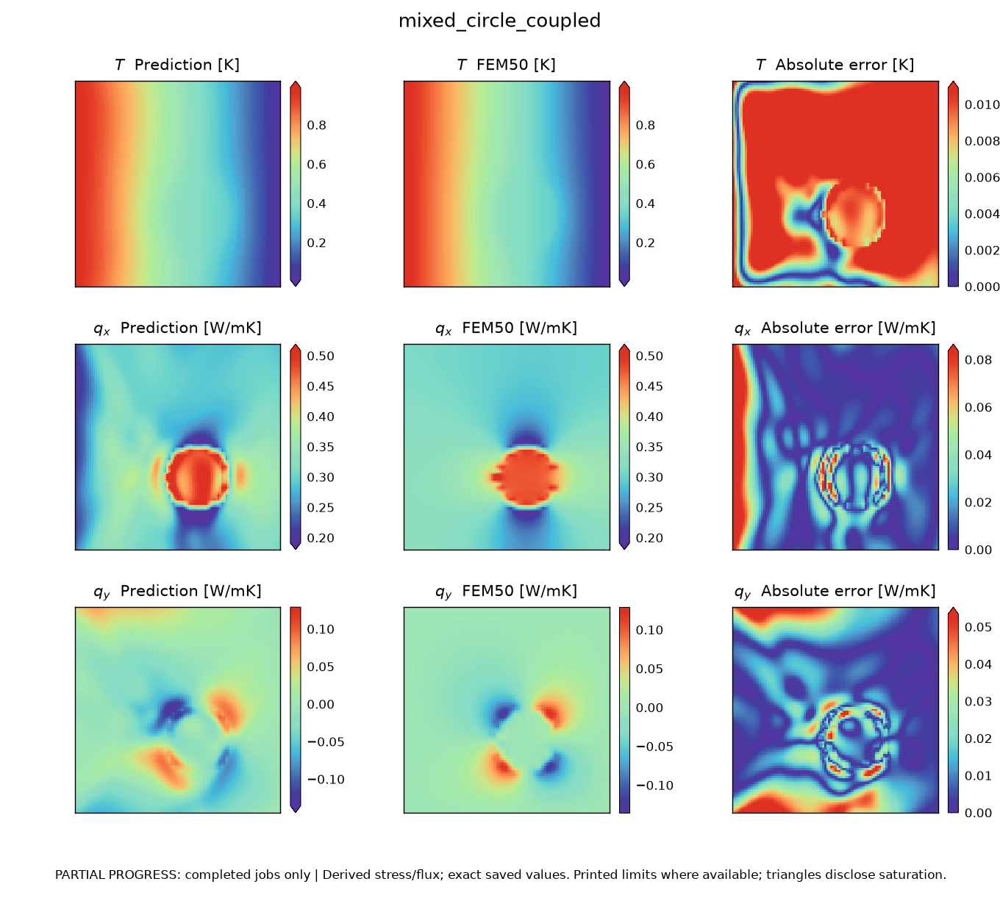

# AM_Project_Reproduce

### 이질 재료의 열탄성 해석을 위한 혼합 물리정보 신경망의 수치 재현

FEniCS 유한요소해와 PyTorch 기반 혼합 물리정보 신경망을 이용하여 Harandi 등의 열탄성 벤치마크를 재현하는 연구 프로젝트입니다. 지배방정식, 학습 과정, 성분별 오차 및 원문의 예외 사례를 실행 가능한 코드와 한국어 보고서로 연결합니다.

> **연구 상태 · 2026-11-05 결과 갱신**<br>
> FEniCS 기준해 **19개**, 등록된 **27개 신경망 실험 중 26개**의 완료 결과를 수록했습니다. 구조 연구 9개와 전이학습 4개를 추가하여 전체 보고서·그림 39개·노트북을 갱신했습니다. Adam 100만 회 실험은 갱신 시점에 학습 중이며, 별도 시간 측정 25개는 미수행입니다. 전체 실험 완료를 의미하지 않습니다.

**기준 논문** · Harandi et al. (2024), *Mixed formulation of physics-informed neural networks for thermo-mechanically coupled systems and heterogeneous domains*, International Journal for Numerical Methods in Engineering, 125(4), e7388. [DOI: 10.1002/nme.7388](https://doi.org/10.1002/nme.7388). 온라인 선게재는 2023년입니다.

## 연구 자료

최신 보고서는 **전체 보고서**, **FEM 보고서**, **간결한 비교 보고서**입니다. Word 비교 보고서는 조건표와 데이터 그림별 관측·의견을 중심으로 구성했습니다. 같은 이름의 파일을 갱신하며 이전 내용은 Git 이력에서 확인합니다.

| 자료 | 내용 |
|---|---|
| [간결한 비교 보고서 · Word](reports/CONCISE_COMPARISON_KO.docx) | FEM·PINN 전체 조건표, 논문 데이터 그림 23개에 대한 자체 계산 결과·비교·의견, 악화 사례 |
| [한국어 연구 보고서 · PDF](reports/FULL_PROJECT_REPORT_KO.pdf) | 국·영문 초록, 정식화, 방법, 결과 및 고찰, 결론, 상세 부록 |
| [전체 보고서 · LaTeX 원본](reports/FULL_PROJECT_REPORT_KO.tex) | 번호가 부여된 수식과 학술 문서 조판 원본 |
| [독립 FEM 보고서 · PDF](reports/FEM_REPORT_KO.pdf) | 약형 유도, 19개 기준해, 균질 해석해 검증, 격자 수렴, 저자 FEAP 자료 비교 |
| [FEM 보고서 · LaTeX 원본](reports/FEM_REPORT_KO.tex) | 신경망 학습과 독립적으로 편집·재생성 가능한 원고 |
| [문서 재생성 안내](docs/LATEX_REPORTS_KO.md) | XeLaTeX 설치, 보고서 생성 및 모든 페이지 검증 |
| [보고서 원고 · Markdown](reports/FULL_PROJECT_REPORT_KO.md) | 검색·수정 가능한 본문과 수치 표 |
| [재현 Jupyter Notebook](notebooks/Full_Paper_Reproduction_KO.ipynb) | 설정 확인, 실제 배열에서 오차 재계산, 그림 재생성, 전체 학습 실행 |
| [결과 그림집 · PDF](reports/FULL_STUDY_FIGURES.pdf) | 논문과 대응하는 색 범위·결과장·단면·손실 이력 |
| [원형 단면 비교의 데이터 출처](docs/FIGURE_11_PROVENANCE_KO.md) | 보고서 그림 3의 자체 학습 결과 6개, FEniCS50, 원논문 Fig. 11 참조 범위와 단면 CSV |
| [재현 절차](docs/REPRODUCTION_GUIDE_KO.md) | 설치, 결과 열람, 재계산, 장기 실행의 구분 |
| [실험 명세](docs/PAPER_EXPERIMENT_INVENTORY.md) | 원문 그림·표·반례의 대응 관계와 미기재 조건 |



*예측값, FEniCS 기준해 및 절대오차를 함께 표시한 실제 계산 결과입니다. 색 범위와 수치 정확도는 별도로 평가합니다.*

추가 결과에서는 신경망 크기에 따른 오차가 단조 감소하지 않았습니다. 미학습 재료비 15에서 물리 손실 가중치 0.1은 데이터 전용 모델보다 8개 성분 중 6개의 평균·최대 정규화오차를 줄였지만, 온도와 수직 열유속은 악화시켰습니다. 수평 열유속의 최대오차는 감소했으므로 원문의 해당 악화 사례와 구분합니다. 비교 기준과 전체 수치는 보고서 10·13절 및 부록에 있습니다.

## 연구 범위

원형·사각형 개재물의 정상 평면변형률 열탄성 문제를 다룹니다. 혼합 PINN, 표준 PINN, 심층 에너지법(DEM)을 비교하고 동시·순차 학습, 경계점 보강, 에너지 항 제외, 경계조건 부과 방식, 신경망 깊이·너비 및 재료비 전이학습을 평가합니다. 성능 개선과 악화가 함께 나타나는 경우 모든 성분의 결과를 보고합니다.

- **물리 모델:** 정상 열전도에서 열팽창으로 이어지는 단방향 연성, 3차원 등방성 평면변형률 구성식.
- **출력 변수:** `ux, uy, sxx, syy, sxy, T, qx, qy`.
- **평가 지표:** 상대 L2 오차, 평균·최대 절대오차, 경계조건 오차 및 FEM 격자 수렴.
- **재현의 한계:** 원문의 미기재 설정은 [프로토콜](docs/FULL_STUDY_PROTOCOL.json)에 명시합니다. 단일 시드 결과이며 원저자의 수치와 완전히 동일한 재현을 주장하지 않습니다.

## 시작하기

Windows Python 3.11 이상과 WSL Ubuntu가 설치된 환경에서 실행합니다. 기본 전체 학습 설정은 NVIDIA CUDA GPU를 사용합니다.

```powershell
git clone https://github.com/JIN9811/AM_Project_Reproduce.git
cd AM_Project_Reproduce
powershell -NoProfile -ExecutionPolicy Bypass -File .\setup.ps1
powershell -NoProfile -ExecutionPolicy Bypass -File .\start_notebook.ps1
```

`notebooks/Full_Paper_Reproduction_KO.ipynb`를 열고 **Harandi CUDA Python 3.11** 커널을 선택합니다. 기본 설정인 `RUN_FULL_STUDY=False`에서는 저장된 자료를 읽고 오차를 다시 계산합니다. 전체 학습은 `RUN_FULL_STUDY=True`로 변경하거나 다음 명령으로 실행합니다.

```powershell
powershell -NoProfile -ExecutionPolicy Bypass -File .\run.ps1 -Task full
```

완료된 실행은 검증 후 재사용합니다. 중단된 실행은 설정이 일치하는 체크포인트에서 이어집니다. 공개 저장소의 자료는 업로드 시점의 스냅샷이므로, 원래 컴퓨터의 현재 실행 상태와 다를 수 있습니다. 자세한 조건은 [전체 실행 안내](docs/README_FULL_STUDY_KO.md)를 참고하십시오.

## 디렉터리 구성

```text
reports/                 전체·FEM 보고서, 간결한 Word 비교 보고서, 그림집과 갤러리
notebooks/               실행 가능한 Jupyter 노트북과 HTML 미리보기
docs/                    재현 안내, 실험 명세, 프로토콜 및 출처
validation/              수식·레이아웃·빌드 검사, 결과 명세와 공개본 상태
harandi/                 FEM, PINN, DEM, 전이학습, 평가 및 시각화
scripts/                 보고서·노트북 생성 및 완료 검증
tests/                   해석해, 미분, 재시작, 결과·출처 검증
data/                    라이선스를 보존한 저자 공개 자료와 색 범위
results/fem_*/           FEniCS 기준해
results/full_study/      검증 완료 실험의 예측·모델·학습 이력
figures/full_study/      직접 계산한 결과의 PNG·SVG
```

메인 폴더에는 이 안내와 설치·실행·설정 파일을 둡니다. 문서 생성 스크립트도 위 경로에 저장합니다. `results/`의 모델·예측 배열·학습 이력과 `figures/`의 원본 그림은 별도로 보존합니다.

## 검증과 출처

완료 여부는 실제 최적화 횟수, 설정, 가중치, 예측 배열과 평가 좌표를 검사하여 판정합니다. `validation/FULL_STUDY_RESULTS.json`은 문서 생성 시점의 완료 목록과 수치 출처를 보존합니다. 검증 설명은 `docs/`, 기계 판독 가능한 검사 기록은 `validation/`에서 확인할 수 있습니다.

문서의 서술·편집은 [한국전산구조공학회 작성 지침](https://www.jcoseik.or.kr/journal-information/instructions-for-authors/)과 국문 공학 논문을 참고했습니다. [참고 자료와 적용 범위](docs/EDITORIAL_REFERENCES_KO.md)에 해당 출처를 명시했습니다.

자체 코드의 라이선스는 [MIT](LICENSE)입니다. 저자 공개 데이터·가중치에는 [원저자 라이선스](data/AUTHORS_LICENSE)가 적용됩니다. 원문 PDF와 원문 그림 발췌는 공개본에 포함하지 않으며, [자료 배포 및 출처 정책](docs/PUBLIC_DISTRIBUTION_KO.md)에 재현 자료의 범위를 정리했습니다.

## 원저자 구현과의 차이

[저자 코드의 표기·구성식 대조](docs/AUTHOR_NOTATION_KO.md)에서 독립 출력과 구성식 출력, 전단 계수 및 일 기반 보조 항을 구분합니다. 공개 FEAP 자료와 관측된 변위 진폭 차이도 별도 FEM 보고서에 기록했으며, 결과를 맞추기 위한 진폭 보정은 적용하지 않았습니다.
