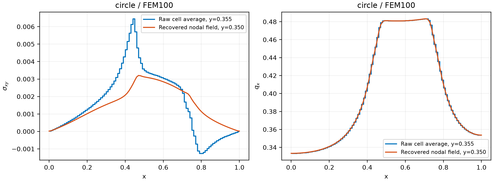
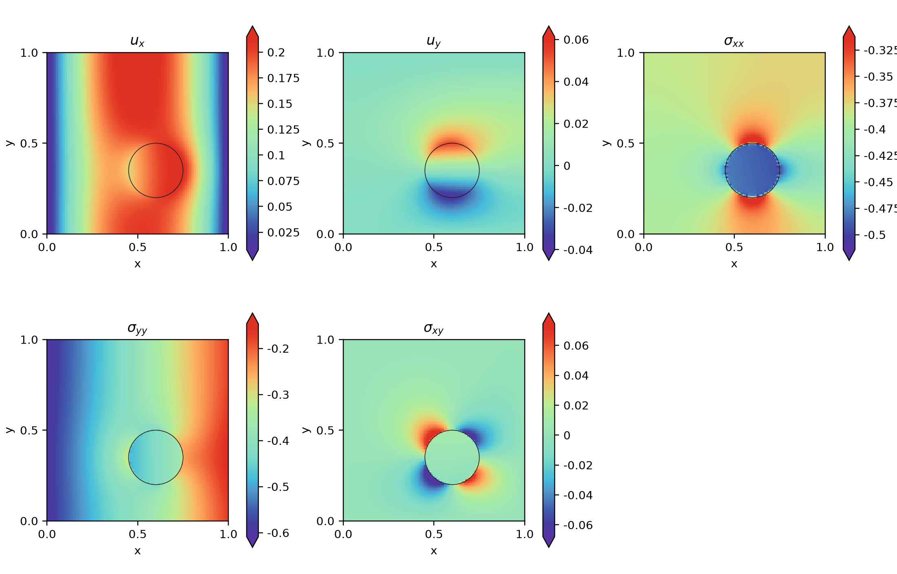
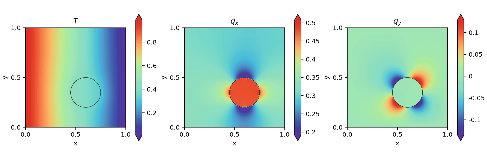
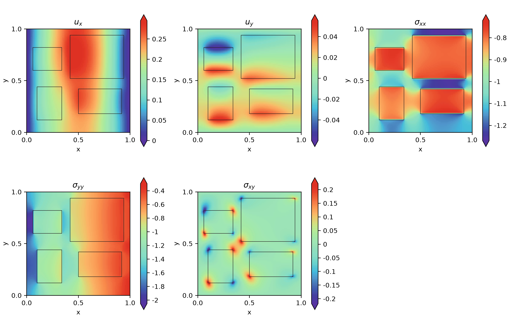
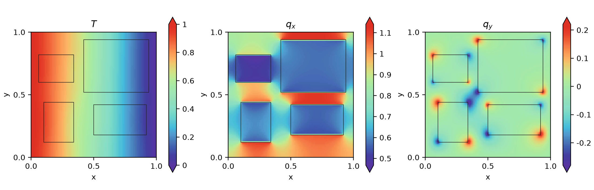
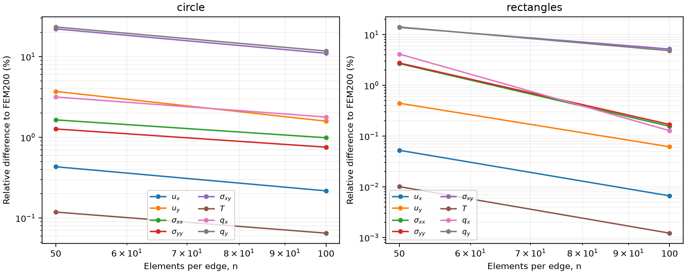

# 이질 재료 열탄성 문제의
FEniCS 유한요소 정식화 및 검증

Finite Element Formulation and Verification of Heterogeneous Thermoelasticity

Harandi 등의 혼합 PINN 연구에 대한 독립 기준해 보고서 | AM Project Reproduce

작성일: 2026-11-05 | XeLaTeX 조판 · 계산 자료 기반 재생성

### 국문 초록

본 보고서는 정상 열전도와 평면변형률 열탄성 문제에 대한 FEniCS 유한요소 기준해의 정식화, 구현 및 검증을 제시한다. 원형 및 사각형 개재물 문제에서 연속 쌍선형 요소를 사용하고, 열전도 해를 열하중으로 전달하여 역학 문제를 순차적으로 해석하였다. 저장된 19개 기준해의 최대 선형 시스템 상대 잔차는 1.842e-13, 최대 열수지 불균형은 2.269e-13이었다. 별도의 균질 해석해 검증에서는 절점 일치와 요소 내부 보간 오차를 구분하였다. 저자 공개 FEAP 자료와 비교한 온도의 상대 $`L^2`$ 차이는 0.0004499%, 변위 벡터의 차이는 2.041%였다. 변위의 약 0.98배 진폭 관계는 관측 결과로만 기록하며 수치해를 보정하지 않았다. 본 보고서는 신경망 학습과 독립적으로 FEM 기준해의 신뢰성과 한계를 설명한다.

핵심용어: 유한요소법, 열탄성, 평면변형률, 이질 재료, FEniCS, 격자 수렴

이 문서의 FEM 검증은 완료되었다. 전체 PINN·전이학습 연구의 완료 여부는 별도의 전체 보고서에 표시한다. 저장된 선형 시스템 잔차는 이산 방정식의 해법 정확도이며, 연속체 문제에 대한 총 오차가 아니다.

이번 자료 갱신에서는 동일한 19개 FEM 기준해의 배열 해시를 다시 확인하고, 완료된 27개 신경망 실험과 연결하였다. 일반 기하의 본문 수치 표는 FEM200, 재료비 15의 전이학습 평가는 별도의 FEM50을 사용한다. 추가 PINN 학습 결과가 FEM 기준해 자체의 신규 계산을 의미하지는 않는다.


---

### Abstract

This report documents a sequential finite element solution of steady heat conduction and plane-strain thermoelasticity in heterogeneous domains using FEniCS. Bilinear quadrilateral elements are used for temperature and displacement. Nineteen saved reference solutions satisfy the discrete equations with a maximum relative algebraic residual of 1.842e-13. Six additional uniform-material runs distinguish nodal exactness from interpolation error. Comparisons with the authors' released FEAP data give relative differences of 0.0004499% in temperature and 2.041% in the displacement vector. The observed amplitude ratio is reported without fitting or rescaling the computed fields.

### 기호

**표 1. 기호**

| 기호 | 정의 |
| --- | --- |
| $`\Omega,\Gamma`$ | 단위 정사각형 영역과 경계 |
| $`\boldsymbol u,T`$ | 변위 벡터와 온도 |
| $`\boldsymbol\sigma,\boldsymbol\varepsilon,\boldsymbol q`$ | Cauchy 응력, 소변형률, 열유속 |
| $`E,\nu,\alpha,k,T_0`$ | 탄성계수, Poisson 비, 열팽창계수, 열전도도, 기준온도 |
| $`\lambda,\mu,\beta`$ | Lamé 상수와 열응력 계수 |
| $`n,h,Q_1,DQ_0`$ | 방향별 요소 수, 요소 크기, 연속 쌍선형 및 불연속 상수 공간 |

목차는 PDF에서 자동 생성된다.


---

## 1. 연구 범위와 원저자 자료의 역할

원논문은 혼합 물리정보 신경망의 성능을 유한요소해와 비교한다. 본 연구는 이를 검토할 독립 기준해를 FEniCS/DOLFIN으로 구성하였다. 저자 공개 저장소는 SciANN 기반 신경망 코드와 FEAP 수치 자료를 제공하며, 본 프로젝트의 FEniCS 코드를 제공한 출처는 아니다. 따라서 해석 대상과 공개 수치 자료를 대조하되, 해석 프로그램·계수 표현·후처리가 같은 것으로 가정하지 않는다.

**표 2. 연구 범위와 원저자 자료의 역할**

| 자료 | 역할 |
| --- | --- |
| 원논문 DOI 10.1002/nme.7388 | 기하·재료·경계조건 및 비교 문제의 근거 |
| phyml4e/PINNs의 `Thermo_mechanic.py` | 출력 변수, 구성식, 일 및 경계조건 표현의 대조 |
| node.txt 및 `rectan_inclus.csv` | 사각형 재료 분포와 외부 FEAP 검증 자료 |
| `harandi/fem.py`, `harandi/physics.py` | 독립적인 FEniCS 조립·해법과 공유 물리 모델 |
| `results/fem_report_verification.json` | 본 보고서에 사용한 해시·잔차·해석해·외부 자료 비교 |

고정한 원저자 커밋은 5b426dc8eb2255b1bb3b8630619228b36cdb464e이다. 저자 코드의 독립 출력과 유도 출력 구분을 따르되, FEM에서는 온도와 변위를 주 미지수로 풀고 응력과 열유속을 구성식으로 계산한다. 신경망에서 독립 응력을 출력하는 혼합 정식화와 FEM의 주 변수 정식화를 혼동하지 않는다.


---

## 2. 지배방정식과 평면변형률 구성식

체적력과 내부 열원이 없는 $`\Omega=(0,1)^2`$에서 정상 문제를 고려한다. 열전도는 변위에 의존하지 않으며, 온도 변화가 열팽창을 통해 역학에만 영향을 준다.

```math
\nabla\!\cdot\boldsymbol\sigma=\boldsymbol0,\qquad\nabla\!\cdot\boldsymbol q=0,\qquad\boldsymbol q=-k\nabla T
\tag{1}
```

```math
\boldsymbol\varepsilon=\tfrac12\left[\nabla\boldsymbol u+(\nabla\boldsymbol u)^{\mathsf T}\right],\qquad\boldsymbol\varepsilon^{\mathrm e}=\boldsymbol\varepsilon-\alpha(T-T_0)\boldsymbol I
\tag{2}
```

```math
\mu=\frac{E}{2(1+\nu)},\qquad\lambda=\frac{E\nu}{(1+\nu)(1-2\nu)},\qquad\beta=\frac{E\alpha}{1-2\nu}
\tag{3}
```

```math
\boldsymbol\sigma=2\mu\boldsymbol\varepsilon+\lambda\operatorname{tr}(\boldsymbol\varepsilon)\boldsymbol I-\beta(T-T_0)\boldsymbol I
\tag{4}
```

평면변형률은 $`\varepsilon_{zz}=0`$을 뜻한다. 면외 탄성변형률 $`\varepsilon^{\mathrm e}_{zz}=-\alpha(T-T_0)`$는 일반적으로 0이 아니므로, 면내 열응력 계수를 평면응력 계수로 대체해서는 안 된다. 면외 응력과 면내 전단응력은 다음과 같다.

```math
\sigma_{zz}=\lambda(u_{x,x}+u_{y,y})-\beta(T-T_0),\qquad\sigma_{xy}=\mu(u_{x,y}+u_{y,x})=2\mu\varepsilon_{xy}
\tag{5}
```

저자 공개 파일의 `strain_xy`는 텐서 전단변형률이며, `sigma_xy`의 계수를 약분하면 $`E/(1+\nu)=2\mu`$이다. 따라서 저자 코드와 본 FEM·PINN은 같은 표준 전단 구성식을 사용한다. 이전 문서에서 공개 코드의 계수가 절반이라고 설명한 부분은 정정한다. 원문의 인쇄 식 49와는 구분하며, 공개 FEAP 자료의 0.98배 변위 관계를 전단 계수 차이로 설명할 근거는 없다. 계산된 해는 수정하지 않았다.


---

## 3. 경계조건과 재료 분포

```math
\begin{aligned}u_x&=0 &&\text{on }x=0,1,& u_y&=0 &&\text{on }y=0,1,\\ T&=1 &&\text{on }x=0,& T&=0 &&\text{on }x=1,\\\boldsymbol t\cdot\boldsymbol\tau&=0 &&\text{on }\partial\Omega,&\boldsymbol q\cdot\boldsymbol n&=0 &&\text{on }y=0,1.\end{aligned}
\tag{6}
```

$`\boldsymbol t=\boldsymbol\sigma\boldsymbol n`$이고 $`\boldsymbol\tau`$는 경계 접선이다. 변위의 법선 성분만 구속하는 롤러 조건이므로 구속 방향의 반력은 일반적으로 0이 아니다. 네 경계를 완전 고정 경계로 바꾸거나 전체 표면력을 0으로 두면 다른 문제가 된다.

**표 3. 경계조건과 재료 분포**

| 문제 | 기지 (E,k) | 개재물 (E,k) | 위치 |
| --- | --- | --- | --- |
| 원형 | (0.3,0.3) | (1,1) | 중심 (0.60,0.35), 반지름 0.15 |
| 사각형 | (1,1) | (0.5,0.5) | 아래 네 사각형 영역 |
| 재료비 문제 | (1,1) | (1/r,1/r) | 사각형; r=1,...,10,15 |

**표 4. 경계조건과 재료 분포**

| 개재물 | x 최소 | x 최대 | y 최소 | y 최대 |
| --- | --- | --- | --- | --- |
| 1 | 0.1 | 0.34 | 0.12 | 0.44 |
| 2 | 0.5 | 0.92 | 0.18 | 0.42 |
| 3 | 0.42 | 0.94 | 0.52 | 0.94 |
| 4 | 0.06 | 0.34 | 0.6 | 0.82 |

공통으로 $`\nu=0.3`$, $`\alpha=1`$, $`T_0=0`$을 사용한다. $`\alpha=1`$과 단위 온도차는 논문 벤치마크를 위한 수치 조건이며 실제 재료의 설계 열하중으로 해석하지 않는다. 논문 내 길이 단위 표기가 일치하지 않으므로 본 문서의 해는 수치 단위 영역을 기준으로 비교한다. 별도의 SI 단위 환산을 수행한 결과는 아니다.

원형 중심은 논문 도해에서 재구성한 값이다. 사각형 중 좌상단 개재물의 높이는 저자 재료 자료에서 0.22이며 인쇄된 치수 0.20과 다르다. 본 보고서는 사용한 실제 좌표를 위 표에 고정하여 재현할 수 있게 하였다.


---

## 4. 약형 정식화

온도 시험함수는 온도 Dirichlet 경계에서 0이고, 변위 시험함수는 롤러가 구속한 성분에서 0이다. 재료 계수가 양수이고 $`-1\lt \nu\lt 1/2`$인 조건을 사용한다.

```math
\begin{aligned}V_T^0&=\{w\in H^1(\Omega):w=0\text{ on }x=0,1\},\\V_u^0&=\{\boldsymbol v\in[H^1(\Omega)]^2:v_x=0\text{ on }x=0,1,\ v_y=0\text{ on }y=0,1\}.\end{aligned}
\tag{7}
```

### 4.1 열전도 약형

열보존식에 시험함수를 곱해 부분적분한다. Dirichlet 경계에서는 시험함수가 0이고 나머지 경계에서는 법선 열유속이 0이므로 경계 적분이 소거된다.

```math
\int_\Omega k\nabla T\cdot\nabla w\,\mathrm d\Omega=-\int_{\Gamma_{N,T}}(\boldsymbol q\cdot\boldsymbol n)w\,\mathrm d\Gamma=0,\qquad \forall w\in V_T^0
\tag{8}
```

### 4.2 역학 약형

대칭 응력을 이용해 변위 구배를 대칭 구배로 치환한다. 롤러 경계의 허용 변위 방향에서 접선력이 0이므로 외부 일은 소거된다. 열응력 항을 우변으로 옮기면 다음 선형 문제를 얻는다.

```math
\begin{aligned}a_u(\boldsymbol u,\boldsymbol v)&=\int_\Omega\left[2\mu\boldsymbol\varepsilon(\boldsymbol u):\boldsymbol\varepsilon(\boldsymbol v)+\lambda(\nabla\cdot\boldsymbol u)(\nabla\cdot\boldsymbol v)\right]\mathrm d\Omega,\\\ell_u(\boldsymbol v;T)&=\int_\Omega\beta(T-T_0)\nabla\cdot\boldsymbol v\,\mathrm d\Omega,\\a_u(\boldsymbol u,\boldsymbol v)&=\ell_u(\boldsymbol v;T)\qquad\forall\boldsymbol v\in V_u^0.\end{aligned}
\tag{9}
```

재료 계면에서는 완전 접합을 가정한다. 변위와 온도는 연속이고, 계면 양쪽의 표면력과 법선 열유속이 균형을 이룬다. 이 조건은 전역 약형에 포함되므로 계면의 $`E`$나 $`k`$를 고전적으로 미분할 필요가 없다. 다만 개별 응력 성분이나 온도 구배가 모두 연속이라는 뜻은 아니다.


---

## 5. 공간 이산화와 FEniCS 구현

```math
T_h=\sum_a N_a T_a,\qquad\boldsymbol u_h=\sum_a N_a\boldsymbol u_a,\qquad N_a|_K\in Q_1(K),\qquad h=1/n
\tag{10}
```

**표 5. 공간 이산화와 FEniCS 구현**

| 항목 | 구현 |
| --- | --- |
| 격자 | UnitSquareMesh.create: n$`\times`$n 정형 사각형 요소 |
| 온도 / 변위 공간 | Q1 스칼라 / 2성분 Q1 벡터 |
| 주 재료 계수 | 요소 중심에서 상을 판별하여 DQ0에 저장 |
| 보간 재료 계수 | 50$`\times`$50 재료 격자의 절점 평균·쌍선형 보간; 별도 FEM100 |
| 적분 / 선형 해법 | `quadrature_degree`=4 / MUMPS 직접해법 |
| 실행 환경 | Ubuntu WSL, DOLFIN 2019.2.0.64.dev0, 단일 MPI rank |
| 평가 격자 | 101$`\times`$101 공통 좌표; 요소 내 Q1 보간 |

```math
\boldsymbol K_T\boldsymbol T=\boldsymbol b_T,\qquad\boldsymbol K_u\boldsymbol U=\boldsymbol f_{\mathrm{th}}(\boldsymbol T)
\tag{11}
```

첫째, 기하와 재료 함수를 생성한다. 둘째, 온도 Dirichlet 조건을 적용한 열전도 시스템을 조립하고 푼다. 셋째, 구한 온도를 열하중으로 대입하여 롤러 조건의 역학 시스템을 푼다. 넷째, 구성식 응력과 Fourier 열유속을 요소 평균으로 투영한다. 마지막으로 원시 값, 복원 값 및 검증 잔차를 저장한다. 단방향 연성의 선형 문제이므로 FEM에서는 열·역학 사이의 반복 학습이 필요하지 않다.

**표 6. 공간 이산화와 FEniCS 구현**

| n | 요소 수 | 온도 자유도 | 변위 자유도 |
| --- | --- | --- | --- |
| 50 | 2500 | 2601 | 5202 |
| 100 | 10000 | 10201 | 20402 |
| 200 | 40000 | 40401 | 80802 |

자유도 수는 경계조건 제거 전의 값이다. 원형 계면은 요소 중심의 상 판별로 근사하므로 격자 세분화 시 기하 근사도 바뀐다. 반면 제시한 사각형 좌표는 50·100·200 격자의 요소 경계에 정렬된다. 두 기하에서 수렴 양상이 다른 이유를 해석할 때 이 차이를 고려한다.


---

## 6. 응력·열유속 복원과 색상 기준

```math
\overline{\boldsymbol g}_K=\frac1{|K|}\int_K\boldsymbol g_h\,\mathrm d\Omega,\qquad\boldsymbol g_i^{\mathrm{rec}}=\frac{\sum_{K\ni i}|K|\overline{\boldsymbol g}_K}{\sum_{K\ni i}|K|},\qquad\boldsymbol g=(\sigma_{xx},\sigma_{yy},\sigma_{xy},q_x,q_y)
\tag{12}
```

원시 요소 평균은 `raw_cell_fields`.xdmf와 HDF5에 불연속 자료로 저장한다. 그림과 공통 평가 좌표의 연속 장은 주변 요소의 면적 가중 평균을 절점에 부여한 뒤 Q1으로 보간한다. 따라서 계면의 급격한 변화는 복원 과정에서 완만해질 수 있다. 원시 장을 보존해야 이 효과와 해법 오차를 분리할 수 있다.



아래 전체장 그림은 논문 인쇄 색막대에서 추출한 팔레트와 논문의 FEM 색상 범위를 사용한다. 범위를 벗어난 값은 양끝 색으로 표시하고 색막대 양끝에 확장 표시를 둔다. 이 처리는 시각 비교를 위한 것이며 원시 배열을 자르거나 진폭을 변경하지 않는다. 범위 밖 비율과 실제 최솟값·최댓값은 `color_scale_audit.json`에 기록한다.


---

## 7. 원형 개재물의 FEM 기준해






---

## 8. 사각형 개재물의 FEM 기준해






---

## 9. 선형 해법 잔차와 열수지 검증

```math
\rho_A=\frac{\|\boldsymbol A\boldsymbol x-\boldsymbol b\|_2}{\max(\|\boldsymbol b\|_2,10^{-30})},\qquad R_T=R_{\mathrm L}+R_{\mathrm R}
\tag{13}
```

열수지는 경계에서 점별 온도 기울기를 미분해 적분한 값이 아니라, Dirichlet 조건으로 수정하기 전의 조립 행렬에 온도 해를 대입하여 얻은 절점 반력을 합산한다. 이 부호 규약에서 왼쪽 반력은 양수, 오른쪽 반력은 음수이다. 외향 열유속 적분은 이 반력의 부호와 반대이다.

**표 7. 선형 해법 잔차와 열수지 검증**

| 기준해 | 열 상대 잔차 | 역학 상대 잔차 | 열 반력 합 |
| --- | --- | --- | --- |
| `circle_n100` | 4.836e-16 | 6.029e-14 | 2.054e-15 |
| `circle_n100_nodal` | 4.681e-16 | 1.241e-13 | -9.992e-15 |
| `circle_n200` | 7.793e-16 | 1.842e-13 | 1.529e-13 |
| `circle_n50` | 3.788e-16 | 2.007e-14 | 1.11e-15 |
| `rectangles_n100` | 1.075e-15 | 4.767e-14 | -1.68e-13 |
| `rectangles_n100_nodal` | 1.069e-15 | 1.014e-13 | -7.117e-14 |
| `rectangles_n200` | 1.686e-15 | 1.481e-13 | -2.269e-13 |
| `rectangles_n50` | 7.903e-16 | 1.579e-14 | -5.596e-14 |
| `ratio_1` | 9.57e-16 | 8.84e-14 | -1.636e-13 |
| `ratio_10` | 7.092e-16 | 8.267e-15 | -4.541e-14 |
| `ratio_15` | 7.777e-16 | 8.373e-15 | -5.39e-14 |
| `ratio_2` | 7.903e-16 | 1.579e-14 | -5.596e-14 |
| `ratio_3` | 7.972e-16 | 1.175e-14 | -7.05e-14 |
| `ratio_4` | 7.662e-16 | 1.059e-14 | -6.106e-14 |
| `ratio_5` | 7.69e-16 | 9.321e-15 | -4.674e-14 |
| `ratio_6` | 7.362e-16 | 9.24e-15 | -4.186e-14 |
| `ratio_7` | 7.795e-16 | 9.349e-15 | -2.842e-14 |
| `ratio_8` | 7.977e-16 | 8.911e-15 | -3.658e-14 |
| `ratio_9` | 7.548e-16 | 8.654e-15 | -4.186e-14 |

19개 기준해에서 최대 상대 잔차는 1.842e-13, 최대 열 반력 합의 절댓값은 2.269e-13이다. 모든 저장 평가점에서 Dirichlet 온도와 구속 변위의 최대 오차는 0.000e+00이다. 작은 잔차와 경계 오차는 조립된 이산 문제의 해를 확인하며, 재료 계면의 공간 근사 오차를 제거하지는 않는다.


---

## 10. 균질 해석해를 이용한 독립 검증

$`E=k=1`$인 균질 문제에서는 다음 해석해를 얻는다. 여기서 $`c=\beta/[2(\lambda+2\mu)]`$이며 $`T_0=0`$이다.

```math
\begin{aligned}T&=1-x,& u_x&=cx(1-x),&u_y&=0,\\q_x&=1,&q_y&=0,&\sigma_{xy}&=0,\\\sigma_{xx}&=-\tfrac12\beta,&\sigma_{yy}&=\lambda c(1-2x)-\beta(1-x).\end{aligned}
\tag{14}
```

서로 독립적인 세 격자와 두 재료 계수 모드에서 실제 FEniCS 계산을 수행하였다. 온도와 변위의 절점 값은 해석해와 부동소수점 정밀도 수준에서 일치한다. 그러나 수평변위 해석해는 이차 함수이므로 Q1 요소 내부에서는 보간 오차가 남는다. 절점만 검사하고 전체 변위장이 정확하다고 결론내리지 않는다.

**표 8. 균질 해석해를 이용한 독립 검증**

| 재료 모드 | n | 절점 u,T 최대오차 | 내부 포함 $`u_x`$ 최대오차 | T 최대오차 |
| --- | --- | --- | --- | --- |
| sharp | 8 | 3.331e-16 | 0.003627 | 3.331e-16 |
| sharp | 16 | 1.443e-15 | 0.0009068 | 1.443e-15 |
| sharp | 32 | 6.051e-15 | 0.0002267 | 6.051e-15 |
| nodal | 8 | 3.331e-16 | 0.003627 | 3.331e-16 |
| nodal | 16 | 1.443e-15 | 0.0009068 | 1.443e-15 |
| nodal | 32 | 6.051e-15 | 0.0002267 | 6.051e-15 |

```math
\|u_x-u_{x,h}\|_\infty=\frac{c\,h^2}{4}\qquad\text{(uniform mesh; exact nodal values)}
\tag{15}
```

표의 내부 평가 격자는 각 요소 중점을 포함한다. 요소 크기를 절반으로 줄이면 수평변위의 최대 보간 오차가 약 4분의 1로 줄어드는 것을 확인한다. 이는 균질 문제에 대한 이차 보간 수렴의 확인이며, 불연속 재료 계면에서 모든 성분에 같은 수렴률을 보장하는 근거는 아니다.


---

## 11. 이질 재료의 격자 수렴

```math
e_{n\mid200}(f)=\frac{\|\boldsymbol f_n-\boldsymbol f_{200}\|_2}{\|\boldsymbol f_{200}\|_2}
\tag{16}
```

모든 해를 동일한 101$`\times`$101 점에 평가하고 FEM200을 상대 비교 기준으로 사용한다. 아래 값은 연속체 해석해에 대한 오차 추정량이 아니라 두 이산 해 사이의 차이이다. 특히 응력·열유속은 앞서 정의한 절점 복원을 거친 값이다.

**표 9. circle의 FEM200 대비 상대 차이 (%)**

| n | $`u_x`$ | $`u_y`$ | $`\sigma_{xx}`$ | $`\sigma_{yy}`$ | $`\sigma_{xy}`$ | T | $`q_x`$ | $`q_y`$ |
| --- | --- | --- | --- | --- | --- | --- | --- | --- |
| 50 | 0.4319 | 3.705 | 1.645 | 1.269 | 22.09 | 0.1185 | 3.165 | 23.33 |
| 100 | 0.2171 | 1.585 | 0.9881 | 0.7549 | 11 | 0.06488 | 1.784 | 11.74 |

**표 10. rectangles의 FEM200 대비 상대 차이 (%)**

| n | $`u_x`$ | $`u_y`$ | $`\sigma_{xx}`$ | $`\sigma_{yy}`$ | $`\sigma_{xy}`$ | T | $`q_x`$ | $`q_y`$ |
| --- | --- | --- | --- | --- | --- | --- | --- | --- |
| 50 | 0.0524 | 0.4436 | 2.686 | 2.758 | 13.85 | 0.01006 | 4.134 | 14.15 |
| 100 | 0.006622 | 0.06141 | 0.1558 | 0.1692 | 5.197 | 0.001218 | 0.1276 | 4.819 |



원형에서는 계면 근사와 복원 영향 때문에 횡열유속·전단응력의 상대 차이가 변위·온도보다 크다. 사각형에서도 국소 모서리장과 작은 성분의 정규화가 상대값을 키울 수 있다. 따라서 “수렴했다”는 판단에는 평가 성분과 허용오차를 명시해야 하며, 하나의 격자를 모든 장의 정답으로 선언하지 않는다.


---

## 12. 재료 표현에 따른 기준해 차이

주 FEM은 요소별 불연속 계수를 사용하지만 PINN은 50$`\times`$50 재료 격자의 절점 평균을 보간한다. 이 두 문제는 계면 주변에서 서로 다른 계수를 갖는다. 이를 분리해 보기 위해 두 기하의 FEM100에 동일 절점 재료장을 사용하는 별도 기준해를 보존하였다.

**표 11. FEM100 절점 재료장과 불연속 재료장의 상대 차이 (%)**

| 기하 | $`u_x`$ | $`u_y`$ | $`\sigma_{xx}`$ | $`\sigma_{yy}`$ | $`\sigma_{xy}`$ | T | $`q_x`$ | $`q_y`$ |
| --- | --- | --- | --- | --- | --- | --- | --- | --- |
| circle | 0.9971 | 9.874 | 1.698 | 1.378 | 18.99 | 0.2441 | 2.98 | 18.28 |
| rectangles | 0.5798 | 4.952 | 3.026 | 3.136 | 11.99 | 0.1442 | 4.385 | 13.58 |

위 차이는 신경망 오차가 아니라 재료 계수 표현 변경에 따른 두 FEM 해의 차이이다. PINN과 불연속 FEM을 비교하면 신경망 근사·최적화·경계 오차에 이 효과도 함께 나타난다. 절점 재료장 FEM과의 비교는 동일 계수 문제의 비교에 더 가깝지만, 양쪽의 공간 미분 및 후처리까지 동일하다는 뜻은 아니다.

### 논문과 그림이 다른 이유의 구분

**표 12. 논문과 그림이 다른 이유의 구분**

| 항목 | 현재 확인한 사실 | 단정할 수 없는 점 |
| --- | --- | --- |
| 구성식 | 저자 공개 코드와 본 구현의 전단 계수는 모두 2$`\mu`$; 원문 인쇄 식 49와 구분 | FEAP 변위 진폭 차이의 단일 원인 |
| 재료 표현 | sharp/nodal 기준해 사이의 실제 수치 차이 | PINN 총 오차 중 각 원인의 정확한 기여율 |
| 후처리 | 요소 평균과 복원 절점 장의 구분 | 논문의 모든 그림에 적용한 내부 복원 설정 |
| 그림 범위 | 논문 팔레트·범위와 범위 밖 비율 기록 | 색상 일치만으로 수치 정확도 입증 |


---

## 13. 저자 공개 FEAP 자료와의 외부 비교

저자 자료의 51$`\times`$51 좌표와 동일한 좌표에서 FEM50을 새로 계산하였다. 비교 파일의 열 순서를 확인하고, 온도와 두 변위 성분을 그대로 사용하였다. 논문 그림을 눈대중으로 맞추는 대신 공개 배열에 대한 차이를 계산하였다.

**표 13. 저자 공개 FEAP 자료와의 외부 비교**

| 비교량 | 측정값 |
| --- | --- |
| 온도 상대 $`L^2`$ 차이 (%) | 0.0004499 |
| 변위 벡터 상대 $`L^2`$ 차이 (%) | 2.041 |
| 최소제곱 진폭비: 저자/FEniCS | 0.9800003020 |
| 진폭 보정 적용 여부 | 적용하지 않음 |
| 평가점 수 | 2601 |

```math
s^*=\frac{\sum_i\boldsymbol u_i^{\mathrm{FEM}}\cdot\boldsymbol u_i^{\mathrm{author}}}{\sum_i\|\boldsymbol u_i^{\mathrm{FEM}}\|^2}
\tag{17}
```

온도는 공개 FEAP 자료와 매우 가깝다. 변위에서는 약 0.98배의 일정한 진폭 관계가 관측된다. 그러나 공개 자료만으로 열팽창계수, 하중, 단위, 후처리 등 어떤 설정이 원인인지 확정할 수 없다. 위 진폭비는 진단 지표이며 FEM/PINN 결과를 보정하는 계수로 사용하지 않는다. 이 차이를 숨긴 채 저자 수치와 완전히 일치한다고 주장하지 않는다.


---

## 14. 결론 및 재현 절차

본 보고서는 실제 FEniCS로 생성한 19개 기준해와 새로 수행한 균질 해석해 검증, 외부 FEAP 자료 비교를 통해 구현을 점검하였다. 선형 시스템 잔차와 열수지는 수치 정밀도 수준이며, 균질 변위의 요소 내부 보간 오차는 예상되는 이차 수렴을 보였다. 이질 재료의 응력·열유속에는 격자와 복원의 영향이 남으므로 FEM200을 절대적인 정답으로 간주하지 않는다.

본 검증은 지정한 평면변형률·롤러 경계·완전 접합·정상 열전도 문제에 한정된다. 면외 변형, 접촉 열저항, 비선형 재료, 시간 의존 열전도, 열원 및 양방향 연성은 검증 범위에 포함하지 않는다. 신경망 전체 실험의 완료와 성능 평가는 전체 보고서를 따른다.

### 14.1 독립 실행

프로젝트 루트에서 다음 명령을 실행한다. 첫 번째 명령은 하나의 기준해를 새 출력 폴더에 생성하는 예이고, 두 번째는 보존된 기준해를 검사하고 균질·외부 자료 검증을 다시 수행한다. 세 번째는 문서용 Python에서 보고서를 생성한다.

```text
python3 -m harandi.fem --geometry circle --n 100 --output results/fem_circle_recheck
python3 scripts/verify_fem_report.py
python scripts/build_fem_report.py
```

첫 두 명령은 FEniCS가 설치된 Ubuntu에서 실행한다. Windows의 WSL 명령과 XeLaTeX 설치 절차는 `docs/LATEX_REPORTS_KO.md`를 따른다. 보고서 생성기는 저장된 NPZ의 해시가 검증 기록과 다르면 중단한다. 신경망 학습을 자동으로 시작하지 않는다.

### 14.2 결과 파일

**표 14. 결과 파일**

| 파일 | 내용 |
| --- | --- |
| `reports/FEM_REPORT_KO.tex` / .md / .pdf | 편집 가능한 LaTeX·Markdown과 최종 PDF |
| `scripts/verify_fem_report.py` | 실제 FEM 검증 및 외부 자료 비교 |
| `scripts/build_fem_report.py` | 수치 재계산·그림·문서 생성 |
| `results/fem_report_verification.json` | 19개 기준해 해시와 추가 검증의 원시 수치 |
| figures/`fem_report`/* | 본 보고서의 그림과 색상 범위 감사 자료 |
| results/fem_*/`raw_cell_fields`.xdmf | 불연속 요소 평균장; ParaView에서 열기 |


---

## 참고문헌 및 출처

Harandi, A., Moeineddin, A., Kaliske, M., Reese, S., Rezaei, S. (2024). Mixed formulation of physics-informed neural networks for thermo-mechanically coupled systems and heterogeneous domains. International Journal for Numerical Methods in Engineering, 125(4), e7388. [DOI 10.1002/nme.7388](https://doi.org/10.1002/nme.7388). 온라인 선게재 2023.

phyml4e/PINNs. [Thermo_mechanic.py](https://github.com/phyml4e/PINNs/blob/5b426dc8eb2255b1bb3b8630619228b36cdb464e/Thermomechanic/Thermo_mechanic.py) 및 같은 폴더의 FEAP·재료 자료. 확인일 2026-11-05. 저자 코드 표기와 수치 자료를 참고하였으며 FEniCS 구현은 본 프로젝트에서 작성하였다.

국문 편집 형식은 한국전산구조공학회의 [논문 작성 지침](https://www.jcoseik.or.kr/journal-information/instructions-for-authors/) 및 `docs/EDITORIAL_REFERENCES_KO.md`에 기록한 국내 논문의 서술 방식을 참고하였다. 참고한 국문 논문의 계산 결과를 본 FEM 검증 자료로 사용하지 않았다.

### 부록: 색상 범위 밖 비율

**표 15. 부록: 색상 범위 밖 비율**

| 기하 | 성분 | 표시 최소 | 표시 최대 | 하한 미만 (%) | 상한 초과 (%) |
| --- | --- | --- | --- | --- | --- |
| circle | $`u_x`$ | 0.008 | 0.215 | 1.98 | 5.784 |
| circle | $`u_y`$ | -0.04 | 0.0613 | 0 | 0 |
| circle | $`\sigma_{xx}`$ | -0.5142 | -0.3124 | 0.03921 | 0.5196 |
| circle | $`\sigma_{yy}`$ | -0.6086 | -0.1464 | 0 | 0 |
| circle | $`\sigma_{xy}`$ | -0.0679 | 0.0745 | 0.2745 | 0.1961 |
| circle | T | 0.0099 | 0.9895 | 0.9901 | 1.235 |
| circle | $`q_x`$ | 0.1914 | 0.5081 | 0.4019 | 0.09803 |
| circle | $`q_y`$ | -0.1354 | 0.1291 | 0.147 | 0.1863 |
| rectangles | $`u_x`$ | 0 | 0.295 | 0 | 1.353 |
| rectangles | $`u_y`$ | -0.0598 | 0.0553 | 0.06862 | 0.05882 |
| rectangles | $`\sigma_{xx}`$ | -1.269 | -0.7224 | 1.176 | 0 |
| rectangles | $`\sigma_{yy}`$ | -2.051 | -0.297 | 0 | 0 |
| rectangles | $`\sigma_{xy}`$ | -0.2178 | 0.2218 | 0.04901 | 0.07842 |
| rectangles | T | 0 | 1 | 0 | 0 |
| rectangles | $`q_x`$ | 0.4677 | 1.141 | 0.1568 | 0.05882 |
| rectangles | $`q_y`$ | -0.2794 | 0.2204 | 0.1274 | 0.1078 |
