AM PROJECT  |  수치 재현 연구

# 이질 재료의 열탄성 해석을 위한
혼합 물리정보 신경망의 수치 재현

Numerical Reproduction of Mixed Physics-Informed Neural Networks
for Thermoelastic Analysis of Heterogeneous Materials

Harandi et al. (2024), DOI 10.1002/nme.7388
진행 보고서 · 2026-11-05 03:19 KST

### 국문초록

본 연구는 이질 재료의 정상 열탄성 문제를 대상으로 혼합 물리정보 신경망의 수치 재현성과 적용 한계를 검토한다. 원형 및 사각형 개재물에 대해 FEniCS 기준해를 구성하고, 혼합·표준 신경망과 심층 에너지법의 예측을 동일 좌표에서 평가하였다. 경계조건 부과 방식, 학습 순서 및 에너지 항의 영향을 성분별 오차로 분석하였다. 원형 문제의 수평변위 상대 $`L^2`$ 오차는 동시 학습 2.86%, 순차 학습 4.78%로, 학습 방식의 우열이 일률적이지 않음을 확인하였다. 본 보고서는 검증된 26개 신경망 실험을 수록하며, 미완료 실험과 원문의 미기재 조건은 별도로 제시한다.

핵심용어: 열탄성, 이질 재료, 물리정보 신경망, 혼합 정식화, 유한요소법, 수치 재현성

**작성 시점의 검증 완료 작업은 26/52개이다.** 미완료 26개 작업은 결과 비교에 넣지 않았다. 이 문서는 전체 학습 완료나 방법의 우세를 주장하지 않는 진행 보고서이다.

정확도 평가용 신경망 실험은 26/27개, 독립 시간 측정은 0/25개 완료되었다. 두 집계를 구분하며, 진행 중인 추가 학습의 중간 체크포인트를 최종 결과 표에 넣지 않는다.

수치 자료 확정 시점: 2026-11-05 03:13 KST. 문서 생성 시각과 별도로 기록한다.

**표 1. 국문초록**

| 구분 | 등록 | 검증 완료 |
| --- | --- | --- |
| 혼합 PINN·구조·추가 예산 | 17 | 16 |
| 표준 PINN·DEM 및 민감도 | 6 | 6 |
| 전이학습 | 4 | 4 |
| 독립 시간 측정 | 25 | 0 |


---

### Abstract

This study examines the numerical reproducibility and limitations of mixed physics-informed neural networks for steady-state thermoelastic problems in heterogeneous materials. FEniCS reference solutions are constructed for circular and rectangular inclusions, and mixed and standard neural networks and the deep energy method are evaluated at identical spatial points. Component-wise errors are used to assess boundary enforcement, training order, and energy terms. For the circular inclusion, the relative $`L^2`$ errors in horizontal displacement are 2.86% for coupled training and 4.78% for sequential training, indicating that neither training strategy is uniformly superior. This report includes 26 verified neural-network experiments and separately identifies unfinished experiments and settings that are unspecified in the source paper.

Keywords: thermoelasticity, heterogeneous materials, physics-informed neural networks, mixed formulation, finite element method, numerical reproducibility

### 기호 및 용어

**표 2. 주요 기호와 수치해석 용어**

| 기호 / 용어 | 정의 |
| --- | --- |
| u, T | 변위 벡터 및 온도 |
| $`\boldsymbol{\sigma}`$, q | Cauchy 응력 텐서 및 열유속 벡터 |
| E, $`\nu`$, $`\alpha`$, k | 탄성계수, Poisson 비, 열팽창계수, 열전도도 |
| FEM / PINN / DEM | 유한요소법 / 물리정보 신경망 / 심층 에너지법 |
| 동시 / 순차 학습 | 열·역학 손실의 공동 최적화 / 장별 교대 최적화 |
| 연성 / 강제 경계조건 | 손실 페널티를 통한 부과(soft) / 출력 변환에 의한 만족(hard) |
| 반복 수 / 상대 $`L^2`$ 오차 | 실제 최적화기 갱신 횟수 / 기준해의 벡터 노름으로 정규화한 오차 |

본 문서는 학술지 게재 논문이 아닌 재현 연구 보고서이다. 국문 공학 논문의 서술 체계를 참고하되, 전체 수치 자료를 확인할 수 있도록 상세 표와 실행 명세를 부록에 수록하였다.


---

## 보고서 읽기와 목차

본문은 물리·수치 방법, 비교의 공정성, 실험별 관측, 재현 및 한계 순으로 구성한다. 부록에는 모든 작업의 정확한 예산·완료 상태, 8개 성분의 오차, 원문 28개 그림과 4개 표의 대응 및 출처 기록을 둔다. 미완료 항목은 숫자 0이 아니라 대기로 표시한다.

목차는 PDF에서 자동 생성된다.


---

## 1. 서론

이질 재료의 열탄성 해석에서는 재료 경계에서 온도 기울기와 응력의 변화가 커지므로, 변위와 온도의 근사 정확도만으로 수치해의 신뢰성을 평가하기 어렵다. 특히 신경망 기반 해석은 잔차의 구성, 경계조건의 부과 및 최적화 절차에 따라 서로 다른 오차 양상을 나타낼 수 있다. 이에 따라 해의 공간 분포와 물리량별 오차를 함께 검토할 필요가 있다.

Harandi 등(2024)은 응력과 열유속을 독립 출력으로 도입한 혼합 정식화를 제시하였다. 본 연구의 목적은 이 정식화를 FEniCS 유한요소해와 비교하여 재현하고, 원문에서 보고한 개선 경향과 예외가 구현 조건에 따라 어떻게 나타나는지 검토하는 데 있다. 이를 위해 원형·사각형 개재물 문제, 비교 방법, 경계조건 민감도, 신경망 구조 및 재료비 전이학습을 하나의 실행 체계로 구성하였다.

### 1.1 연구 범위와 재현의 수준

원문의 실험 기록 수와 실제 실행 작업 수는 일치하지 않는다. 깊이·너비 연구의 5$`\times`$40은 중복되며, 부록 B는 하드 L-BFGS 전체장과 연결된다. Table 4의 25개 조합은 100 업데이트의 시간 측정이지 25개 추가 10k 수렴 연구가 아니다. Remark 7의 1M Adam은 Table 1과 구분한 추가 연속 실행이고, 두 DEM 하드 경계 제어는 원문에 없는 공정성 민감도 연구이다.

현재 목록은 정확도·물리 비교용 27개와 시간 측정용 25개 작업으로 구성된다. 각 작업의 분류와 예산은 하드코딩한 완료 문구가 아니라 실행 시점의 catalogue에서 읽는다.

### 1.2 수치 결과의 검증 기준

완료 판정은 설정 일치, 실제 업데이트 수, 최종 상태, 101$`\times`$101 예측 배열의 유한성, 가중치의 유한성 및 모델 구조 적합성을 확인한다. 체크포인트나 그림이 존재하는 것만으로 완료를 인정하지 않는다. 보고서 생성기는 별도의 프로젝트 Python에서 이 검사를 수행한 뒤, 완료 예측의 직접·미분 출력 오차를 NPZ로 다시 계산한다. 부분 결과·짧은 시험·기존 빠른 실행은 전체 예산의 결과로 대체하지 않는다.

**표 3. 수치 결과의 검증 기준**

| 자료 | 역할 |
| --- | --- |
| `docs/PAPER_EXPERIMENT_INVENTORY.json` | 원문 본문·그림·표의 감사 목록 |
| `docs/FULL_STUDY_PROTOCOL.json` | 재구성 선택과 전체 학습 계획 |
| `validation/FULL_STUDY_RESULTS.json` | 검증된 그림·출처 해시·수치 비교 |
| results/`full_study`/* | 실제 설정·모델·예측·손실·완료 상태 |
| `notebooks/Full_Paper_Reproduction_KO.ipynb` | 편집 가능한 실행·독립 재계산 절차 |

그림집 생성 시점의 완료 목록과 현재 검증 목록이 다르면, 보고서는 현재 검증 결과와 새로 계산한 오차를 기준으로 한다. 엄격한 최종 보고서는 그림집도 최신 전체 완료 상태여야 생성된다.


---

## 2. 물리적 문제와 경계조건

영역 $`\Omega`$=[0,1]$`\times`$[0,1]에서 정상 열전도와 소변형 등방성 열탄성을 계산한다. 열전도 해가 열팽창을 통해 역학에 영향을 주며, 역학이 열전도에 되먹임하는 열원이나 재료 변화는 포함하지 않는다. 3차원 평면변형률 조건 $`\varepsilon_{zz}`$=0을 적용하되 면외 열변형률과 면외 응력을 에너지에서 무시하지 않는다.

```math
\nabla\!\cdot\boldsymbol{\sigma}=\boldsymbol{0},\qquad \nabla\!\cdot\boldsymbol{q}=0,\qquad \boldsymbol{q}=-k\nabla T
\tag{1}
```

```math
\boldsymbol{\varepsilon}(\boldsymbol{u})=\tfrac12\!\left[\nabla\boldsymbol{u}+(\nabla\boldsymbol{u})^{\mathsf T}\right],\qquad \mu=\frac{E}{2(1+\nu)},\qquad \lambda=\frac{E\nu}{(1+\nu)(1-2\nu)}
\tag{2}
```

```math
\boldsymbol{\sigma}=2\mu\boldsymbol{\varepsilon}+\lambda\operatorname{tr}(\boldsymbol{\varepsilon})\boldsymbol{I}-\beta(T-T_0)\boldsymbol{I},\qquad \beta=\frac{E\alpha}{1-2\nu}
\tag{3}
```

공통 값은 $`\nu=0.3`$, $`\alpha=1`$, $`T_0=0`$이다. 좌우 경계에서 $`u_x=0`$, 상하에서 $`u_y=0`$이며 네 변의 접선력은 0이다. 왼쪽 $`T=1`$, 오른쪽 $`T=0`$이고 상하는 단열 $`q_y=0`$이다. 전단응력은 $`\sigma_{xy}=\mu(u_{x,y}+u_{y,x})`$로 계산한다. $`\alpha=1`$은 벤치마크 값이며 실제 재료의 열팽창 계수로 해석하지 않는다.

**표 4. 물리적 문제와 경계조건**

| 기하 | 기지 E,k | 개재물 E,k | 좌표/재료 선택 |
| --- | --- | --- | --- |
| 원형 | 0.3, 0.3 | 1.0, 1.0 | 중심 (0.60,0.35), 반지름 0.15 |
| 사각형 | 1.0, 1.0 | 0.5, 0.5 | 저자 제공 재료 자료의 네 사각형 |
| 전이학습 | 1.0, 1.0 | 1/r, 1/r | matrix/inclusion 비율 r |

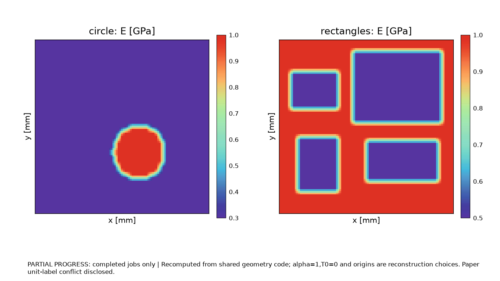

원문 도해의 $`\mu`$m와 본문·축의 mm가 충돌한다. 본 프로젝트는 수치 단위 영역을 사용하고 mm, GPa, K, W/mK는 원문 벤치마크 표기임을 밝힌다. 실제 SI 열유속에는 길이·온도 차에 따른 환산이 필요하다.


---

## 3. FEniCS 기준해와 오차 정의

Q1 사각형 유한요소로 열전도 선형 시스템을 먼저 풀고 온도 해를 열하중으로 대입하여 변위를 구한다. 주 기준해는 요소 중심의 불연속 재료 구분을 사용한다. 신경망에는 50$`\times`$50 재료 격자의 절점 평균·쌍선형 보간 계수가 쓰인다. 두 재료 표현의 차이는 지워서는 안 되며, 동일 절점 재료장의 별도 기준해로도 확인할 수 있다.

```math
\begin{aligned}\int_\Omega k\nabla T_h\!\cdot\nabla w_h\,\mathrm d\Omega&=0,\\\int_\Omega\!\left[2\mu\boldsymbol{\varepsilon}(\boldsymbol{u}_h):\boldsymbol{\varepsilon}(\boldsymbol{v}_h)+\lambda(\nabla\!\cdot\boldsymbol{u}_h)(\nabla\!\cdot\boldsymbol{v}_h)\right]\mathrm d\Omega&=\int_\Omega\beta(T_h-T_0)\nabla\!\cdot\boldsymbol{v}_h\,\mathrm d\Omega.\end{aligned}
\tag{4}
```

응력·열유속의 요소 평균값을 보존하고, 비교용 연속 절점값은 명시적인 주변 요소 복원으로 만든다. 국소 경계에서 복원 방식과 재료 불연속은 최대오차에 영향을 준다. 선형 시스템의 잔차가 작다는 사실은 이산 해법 검증이며 공간 이산화 오차가 0이라는 의미는 아니다.

**표 5. FEniCS 기준해와 오차 정의**

| 기하 | 요소/변 | 열 잔차 | 역학 잔차 | 열수지 |
| --- | --- | --- | --- | --- |
| circle | 200 | 7.793e-16 | 1.842e-13 | 1.529e-13 |
| rectangles | 200 | 1.686e-15 | 1.481e-13 | -2.269e-13 |

### 평가 기준과 세 가지 다른 상대화

본문·부록의 일반 실행 정량 기준은 FEM200이며, 비율 15만 별도 FEM50을 사용한다. 원문 형식 그림은 FEM50을 사용하는 경우가 있으므로 그림 캡션의 기준을 따른다. 모든 신경망 평가는 101$`\times`$101 좌표이다. 직접 혼합 출력과 변위·온도 미분으로 얻은 구성식/Fourier 출력은 별도로 계산한다.

```math
\begin{aligned}e_{L^2}(f)&=\frac{\|\widehat{\boldsymbol f}-\boldsymbol f^{\mathrm{ref}}\|_2}{\|\boldsymbol f^{\mathrm{ref}}\|_2},\qquad e_{\mathrm{MAE}}(f)=\frac1N\sum_{i=1}^{N}|\widehat f_i-f_i^{\mathrm{ref}}|,\\ e_{\mathrm{mean,peak}}(f)&=\frac{e_{\mathrm{MAE}}(f)}{\max_i|f_i^{\mathrm{ref}}|},\qquad e_{\mathrm{max,peak}}(f)=\frac{\max_i|\widehat f_i-f_i^{\mathrm{ref}}|}{\max_i|f_i^{\mathrm{ref}}|}.\end{aligned}
\tag{5}
```

평균 절대오차, 최대 절대오차와 상대 $`L^2`$는 서로 다른 기준이다. 기준해가 0인 분모는 정의하지 않고 빈값으로 남긴다. 작은 전단·횡열유속 성분은 상대오차가 커질 수 있으므로 절대오차와 함께 읽는다. 본 정의가 원문의 모호한 평균 상대오차 문구와 완전히 동일하다고 단정하지 않는다.


---

## 4. 혼합 PINN과 학습 절차

8개 독립 스칼라 신경망이 $`u_x`$, $`u_y`$, $`\sigma_{xx}`$, $`\sigma_{yy}`$, $`\sigma_{xy}`$, T, $`q_x`$, $`q_y`$를 출력한다. 기본은 각각 5개 은닉층·층당 40개 tanh 뉴런이다. 독립 응력·열유속 출력은 평형·보존식의 1차 미분을 가능하게 하며, 구성식 및 Fourier 연결 손실이 주 변수의 미분 결과와 맞춘다.

원형의 기본 배치는 51$`\times`$51 직교 격자와 시드가 고정된 내부 균등 난수 2,399점으로 총 5,000점이다. 원문 그림 5의 계면·경계 보강점 좌표는 공개되지 않았으므로 그 분포를 그대로 재현하지 않았다. 같은 점 개수가 같은 배치 또는 같은 정확도를 뜻하지 않는다. 각 점의 동일 가중치도 면적에 정확한 적분 공식과 구분한다.

```math
\begin{aligned}\mathcal L&=\mathcal L_{\mathrm M}+\mathcal L_{\mathrm T},\\\mathcal L_{\mathrm M}&=\mathcal L_{\mathrm{link},\sigma}+\mathcal L_{\mathrm{eq}}+\mathcal L_{\mathrm D,u}+\mathcal L_{\mathrm N,t}+\mathcal L_{\mathrm E,M},\\\mathcal L_{\mathrm T}&=\mathcal L_{\mathrm{link},q}+\mathcal L_{\mathrm{div},q}+\mathcal L_{\mathrm D,T}+\mathcal L_{\mathrm N,q}+\mathcal L_{\mathrm E,T}.\end{aligned}
\tag{6}
```

아래 첨자 $`\mathrm{link}`$는 독립 출력과 구성식의 연결, $`\mathrm{eq}`$는 역학 평형, $`\mathrm D`$와 $`\mathrm N`$은 각각 Dirichlet 및 Neumann 경계조건, $`\mathrm E`$는 일 기반 보조 항을 뜻한다. 에너지 항은 저자 코드의 내부 일과 경계 외부 일의 차를 사용한다. 이 항은 온도를 고정한 열탄성 퍼텐셜 에너지와 동일하지 않으며, 정확해에서 반드시 0이 되는 잔차로 해석해서는 안 된다.

### 4.1 원저자 구현과 수식 표기의 대응

원저자 공개 저장소 phyml4e/PINNs의 `Thermomechanic/Thermo_mechanic.py`를 대조하였다. 공개 파일은 SciANN/TensorFlow를 사용하고, 좌표를 입력으로 하는 8개 독립 함수와 강제 경계 출력 변환을 정의한다. 본 프로젝트는 같은 물리량 구분을 PyTorch로 구현하되, 논문의 소프트 경계 주 실험과 공개 코드의 하드 경계 실행을 구분한다.

**표 6. 원저자 코드와 본 보고서의 표기 대응**

| 저자 코드의 변수 | 보고서 표기 | 의미 |
| --- | --- | --- |
| `sig_x_O`, `sig_y_O`, `sig_xy_O` | $`\widehat\sigma_{xx},\widehat\sigma_{yy},\widehat\sigma_{xy}`$ | 독립 응력 신경망의 출력 |
| `sigma_x`, `sigma_y`, `sigma_xy` | $`\sigma_{xx}(\boldsymbol u,T),\sigma_{yy}(\boldsymbol u,T),\sigma_{xy}(\boldsymbol u)`$ | 변위 미분과 온도에서 계산한 구성식 응력 |
| `q_x_O`, `q_y_O` | $`\widehat q_x,\widehat q_y`$ | 독립 열유속 신경망의 출력 |
| `q_x`, `q_y` | $`-kT_{,x},-kT_{,y}`$ | Fourier 법칙에서 계산한 열유속 |
| `EQ1_m`-`EQ3_m`; `EQ1_t`-`EQ2_t` | $`\mathcal L_{\mathrm{link},\sigma},\mathcal L_{\mathrm{link},q}`$ | 독립 출력과 유도 출력의 연결 조건 |
| `PDE1_m`, `PDE2_m`; `PDE1_t` | $`\nabla\cdot\widehat{\boldsymbol\sigma},\nabla\cdot\widehat{\boldsymbol q}`$ | 독립 출력의 1차 미분 잔차 |

```math
\begin{aligned}\boldsymbol r_{\sigma}&=\widehat{\boldsymbol\sigma}-\boldsymbol\sigma(\boldsymbol u,T),&\quad\boldsymbol r_q&=\widehat{\boldsymbol q}+k\nabla T,\\\boldsymbol r_{\mathrm M}&=\nabla\!\cdot\widehat{\boldsymbol\sigma},&r_{\mathrm T}&=\nabla\!\cdot\widehat{\boldsymbol q}.\end{aligned}
\tag{7}
```

저자 파일의 `strain_xy`는 텐서 전단변형률 $`\varepsilon_{xy}=(u_{x,y}+u_{y,x})/2`$이며, `sigma_xy`에 곱하는 계수는 통상적인 평면변형률 구성식과 2배 차이를 보인다. 본 구현은 $`\sigma_{xy}=2\mu\varepsilon_{xy}=\mu(u_{x,y}+u_{y,x})`$로 통일하였다. 이는 원저자 파일의 문자 단위 복제가 아니라, 명시된 등방성 열탄성 모델에 대한 수정이다. 원문·공개 코드·재구성의 차이를 지운 채 동일 재현으로 서술하지 않는다.

출처: [저자 코드의 출력·구성식 정의](https://github.com/phyml4e/PINNs/blob/5b426dc8eb2255b1bb3b8630619228b36cdb464e/Thermomechanic/Thermo_mechanic.py#L17-L55); [일·연결·평형 손실](https://github.com/phyml4e/PINNs/blob/5b426dc8eb2255b1bb3b8630619228b36cdb464e/Thermomechanic/Thermo_mechanic.py#L175-L278). 고정 커밋: 5b426dc8eb2255b1bb3b8630619228b36cdb464e.

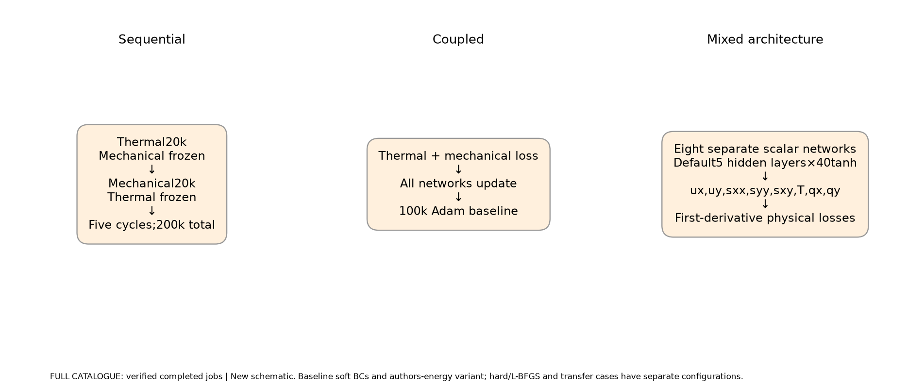

동시 학습은 두 장의 손실을 함께 최소화한다. 순차 학습은 한 장의 파라미터만 갱신하고 다른 장을 고정한다. 순차의 역학 블록에서 온도는 처방된 입력이므로 기계 에너지의 온도 방향 기울기를 차단한다. 본 구현은 열 블록 이후 새 역학 블록에서 Adam 상태를 재설정한다. 이 정책은 원문에 명시되지 않은 선택이다.

float64와 시드 42를 유지한다. CUDA 그래프 및 tanh 연쇄법칙의 공간 미분 가속은 동일 목적함수·업데이트를 목표로 검증했으나, 부동소수점 연산 순서에 따른 장기 궤적 차이가 가능하다. 정밀도나 예정 예산을 줄인 결과로 치환하지 않는다.


---

## 5. 비교 해법과 경계조건의 영향

### 표준 PINN

주 변수 $`u_x`$, $`u_y`$, T만 출력하고 응력·열유속은 미분하여 만든다. 평형·열보존 잔차에는 공간 2차 미분과 재료 계수 미분이 필요하다. 절점 쌍선형 재료장의 보간 결절에서는 고전적 미분이 정의되지 않으므로 표준 PINN의 내부 배치는 재현 가능한 비결절 점을 사용한다. 이것은 방법 비교에 영향을 주는 공개된 정규화·배치 선택이다.

### 심층 에너지법(DEM)

DEM은 주 변수의 1차 미분으로 열전도 에너지와 평면변형률 탄성 에너지를 최소화한다. 열 에너지는 $`\frac12\int_\Omega k\vert \nabla T\vert ^2\,\mathrm d\Omega`$이고, 역학 에너지는 온도를 고정한 상태의 완전한 평면변형률 탄성 에너지다. 기본 자연 경계는 변분 문제에 포함하며 별도 Neumann 페널티를 임의로 추가하지 않는다. 기본 비교는 단위 가중치의 소프트 Dirichlet 페널티를 사용하고 하드 경계 제어를 추가한다.

**동시 DEM의 온도 기울기 처리도 구현 선택이다.** 역학 에너지를 계산할 때 T를 처방값으로 취급하여 그 항에서 온도망으로 가는 기울기를 차단한다. 반면 동시 표준·혼합 PINN은 역학 손실의 기울기가 온도망으로 전달된다. 이 선택은 열전도에서 역학으로 향하는 단방향 물리를 위한 변분 재구성이며, 원문 식 14의 문구를 그대로 따른 u,T 공동 최소화는 아니다. 따라서 방법 간 차이에는 이 최적화 경로의 차이도 포함된다.

### 소프트 페널티 편향을 방법 자체의 실패와 구분

균질 1차원 단위 구간에서 T(x)=ax+b라 두고 단위 경계 페널티를 쓰면 다음 목적함수가 된다. 이는 학습 결과를 꾸며낸 예시가 아니라 해석적으로 계산할 수 있는 비교 진단이다.

```math
\begin{aligned}J(a,b)&=\tfrac12a^2+(b-1)^2+(a+b)^2,\\\frac{\partial J}{\partial a}&=3a+2b=0,\qquad \frac{\partial J}{\partial b}=2a+4b-2=0,\\(a^*,b^*)&=\left(-\tfrac12,\tfrac34\right),\qquad T^*(x)=\tfrac34-\tfrac12x.\end{aligned}
\tag{8}
```

이 최소해의 경계값은 0.75와 0.25이며, 정확한 강제 경계 해 T=1-x와 다르다. J는 정확한 경계 해의 0.5보다 소프트 최소해의 0.25에서 더 작다. 따라서 최적화가 성공해도 유한한 페널티는 Dirichlet 문제의 정답을 그대로 최소화하지 않을 수 있다. 하드 경계 제어는 이 편향과 DEM의 표현력·최적화 한계를 분리하기 위해 필요하다.

**표 7. 소프트 페널티 편향을 방법 자체의 실패와 구분**

| 비교 | 읽는 원칙 |
| --- | --- |
| 기본 소프트 DEM | 원문의 비교 구조를 재구성하되 경계 페널티 편향을 공개 |
| 추가 하드 DEM 두 방식 | 동일 방법에서 경계 처리에 따른 민감도를 확인하는 추가 연구 |
| 방법 간 우세 판단 | 성분별 실제 오차·경계 오차·예산을 함께 보고한다 |
| 순차 열 장 | 역학을 바꾸어 비활성 열손실이 변하도록 인위적 역연성을 만들지 않는다 |


---

## 6. 수치실험의 구성 및 학습 조건

**표 8. 수치실험의 구성 및 학습 조건**

| 실험군 | 설정·예산 | 출처/선택 |
| --- | --- | --- |
| 주 혼합 PINN 4개 | 원형/사각형 $`\times`$ 동시/순차; Adam 100k 또는 200k 총 업데이트; 5$`\times`$40; soft | Table 1, 4.1-4.2절 |
| 표준 PINN·DEM 4개 | 원형 $`\times`$ 두 방법 $`\times`$ 두 방식; 각 장 100k; soft | 4.1.2절; 세부 페널티는 재구성 |
| 하드 DEM 제어 2개 | 기본 DEM과 같은 예산, hard 경계 | 원문 외 공정성 민감도 |
| 경계 보강·에너지 제외 | 각 100k 동시 Adam; 왼쪽 추가 1,000점 / energy=none | 그림 15 / 정성적 절제 연구 |
| 하드 Adam | 사각형 동시 10k, 5$`\times`$40 | 그림 17-18 |
| 하드 L-BFGS 구조 9개 | 각 10k; 깊이 1,2,4,5,6$`\times`$40 및 5층$`\times`$5,10,20,40,60 | 그림 19-21; 5$`\times`$40 중복 제외 |
| 전이학습 4개 | 비율 1-10 각 Adam 10k; 가중치 0,0.1,0.5,1; 테스트 15 | 4.4절; 0.5 추가 선택 |
| 시간 연구 25개 | 5깊이$`\times`$5너비 각 L-BFGS 100회; 단일 작업 | Table 4 |
| Remark 7 추가 실행 | 사각형 Adam 1M; 100k 궤적에서 900k 추가 | 본문 문구 충돌; soft는 재구성 |

부록 A는 이 요약을 실제 작업 ID와 연결한다. 순차 학습의 총 업데이트 수는 두 장을 합친 수이며 각 장의 배분도 보존한다. L-BFGS의 한 업데이트에는 여러 closure 평가가 들어갈 수 있어 Adam과 반복 수만으로 비용을 비교하지 않는다.

### 중단·재시작과 선택 편향

체크포인트는 모델과 최적화기 상태, 진행 위치, 누적 시간을 함께 저장한다. 전이학습은 비율 내부의 Adam 상태를 보존하고 비율 경계에서 모델 가중치만 전달한다. 최종 비교는 마지막 예정 업데이트를 사용한다. 비율 15의 오차로 조기 종료하거나 좋은 시드·체크포인트만 선택하지 않는다. 결과가 나쁘더라도 완료 기준을 충족한 실행은 보고한다.


---

## 7. 수치 결과 및 고찰: 기본 벤치마크

원형 문제에서는 혼합 PINN, 표준 PINN 및 DEM에 동시·순차 학습을 적용한 여섯 조건을 비교한다. 사각형 문제에서는 혼합 PINN의 두 학습 방식을 평가한다. 비교 지표는 성분별 평균 및 최대 정규화오차이며, 각 방법의 경계조건과 학습 횟수를 함께 제시한다. 원문에서 보고한 방법 간 경향의 재현 여부는 이 수치 비교를 기준으로 판단한다.

**표 9. 수치 결과 및 고찰: 기본 벤치마크**

| 실행 | $`u_x`$ | $`\sigma_{xx}`$ | T | $`q_x`$ |
| --- | --- | --- | --- | --- |
| J03 | 1.792 | 2.387 | 1.215 | 3.548 |
| J04 | 2.755 | 2.403 | 1.189 | 3.647 |
| J05 | 19.6 | 35.63 | 20.64 | 45.03 |
| J06 | 11.7 | 11.48 | 4.337 | 11.76 |
| J07 | 34.42 | 29.74 | 6.255 | 15.31 |
| J08 | 48.61 | 46.9 | 6.255 | 15.31 |
| J01 | 4.325 | 2.202 | 0.8511 | 3.684 |
| J02 | 2.205 | 2.538 | 0.6161 | 3.999 |

표의 값은 평균 절대오차/기준해 최대 절댓값(%)이다. 일반 실행 FEM200, 비율 15는 별도 FEM50을 기준으로 하며, 구성식/Fourier 출력을 사용한다. 전체 8성분·직접 출력은 부록 B에 있다.

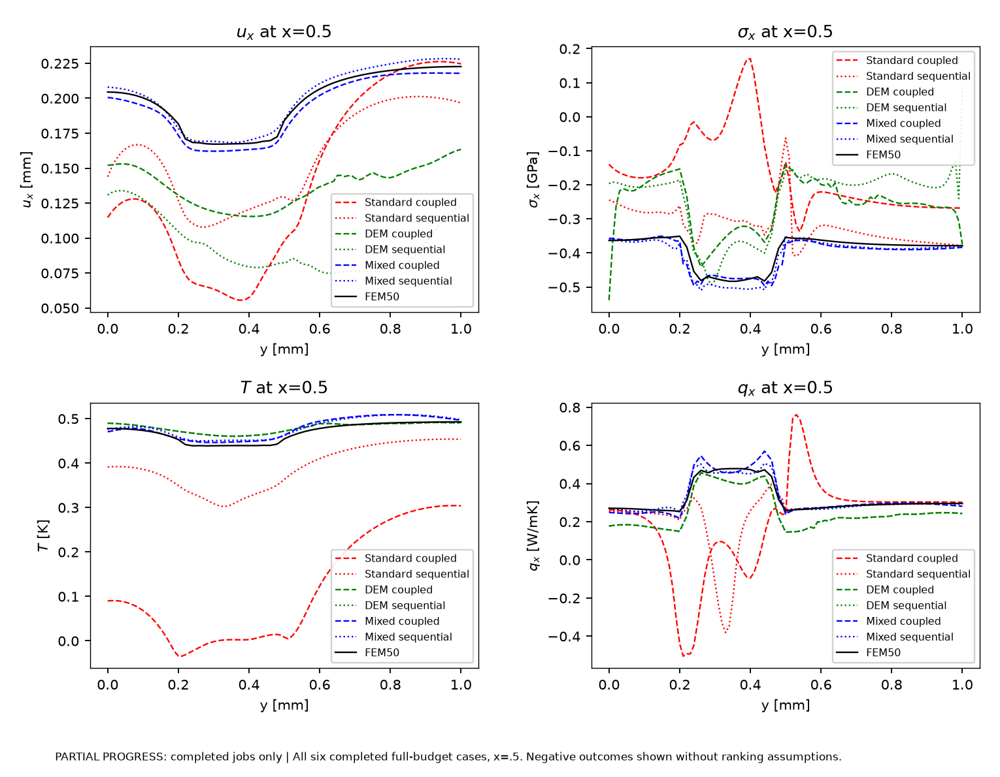

곡선별 원본·학습 횟수·단면 CSV: [데이터 출처 명세](https://github.com/JIN9811/AM_Project_Reproduce/blob/main/docs/FIGURE_11_PROVENANCE_KO.md). 응력·열유속은 구성식/Fourier 출력이다.

### 동시·순차의 성분별 비교

**표 10. 동시·순차의 성분별 비교**

| 성분 | J04 - J03 평균(pp) | 최대(pp) |
| --- | --- | --- |
| $`u_x`$ | 0.963 | 2.959 |
| $`u_y`$ | -16.03 | -17.59 |
| $`\sigma_{xx}`$ | 0.01606 | 3.765 |
| $`\sigma_{yy}`$ | -0.2256 | -7.183 |
| $`\sigma_{xy}`$ | -0.5728 | 19.69 |
| T | -0.02643 | 0.2167 |
| $`q_x`$ | 0.0986 | -0.3147 |
| $`q_y`$ | -0.7119 | -3.417 |

왼쪽 실행의 평균오차가 작은 성분은 5/8개, 최대오차가 작은 성분은 4/8개이다. 양의 변화는 악화, 음의 변화는 개선이다. 단일 시드 결과이며 통계적 우세나 모든 상황의 순위로 확대하지 않는다.

**표 11. 동시·순차의 성분별 비교**

| 성분 | J02 - J01 평균(pp) | 최대(pp) |
| --- | --- | --- |
| $`u_x`$ | -2.119 | -2.999 |
| $`u_y`$ | 4.905 | 7.762 |
| $`\sigma_{xx}`$ | 0.3357 | 2.704 |
| $`\sigma_{yy}`$ | 0.1067 | 1.329 |
| $`\sigma_{xy}`$ | 2.248 | 156.9 |
| T | -0.235 | -0.7635 |
| $`q_x`$ | 0.3154 | -1.944 |
| $`q_y`$ | 0.4367 | -2.281 |

왼쪽 실행의 평균오차가 작은 성분은 2/8개, 최대오차가 작은 성분은 4/8개이다. 양의 변화는 악화, 음의 변화는 개선이다. 단일 시드 결과이며 통계적 우세나 모든 상황의 순위로 확대하지 않는다.

### 추가 DEM 경계 민감도

**표 12. 추가 DEM 경계 민감도**

| 실행 | $`u_x`$ | $`\sigma_{xx}`$ | T | $`q_x`$ |
| --- | --- | --- | --- | --- |
| J09 | 2.577 | 9.489 | 1.668 | 10.85 |
| J10 | 8.061 | 23.13 | 1.668 | 10.85 |

표의 값은 평균 절대오차/기준해 최대 절댓값(%)이다. 일반 실행 FEM200, 비율 15는 별도 FEM50을 기준으로 하며, 구성식/Fourier 출력을 사용한다. 전체 8성분·직접 출력은 부록 B에 있다.

**표 13. 추가 DEM 경계 민감도**

| 성분 | J09 - J07 평균(pp) | 최대(pp) |
| --- | --- | --- |
| $`u_x`$ | -31.84 | -60.14 |
| $`u_y`$ | -96.11 | -95.26 |
| $`\sigma_{xx}`$ | -20.25 | -172.4 |
| $`\sigma_{yy}`$ | -15.73 | 651.9 |
| $`\sigma_{xy}`$ | -4.089 | -7476 |
| T | -4.587 | -8.375 |
| $`q_x`$ | -4.462 | 3254 |
| $`q_y`$ | 22.56 | 1.732e+04 |

왼쪽 실행의 평균오차가 작은 성분은 7/8개, 최대오차가 작은 성분은 5/8개이다. 양의 변화는 악화, 음의 변화는 개선이다. 단일 시드 결과이며 통계적 우세나 모든 상황의 순위로 확대하지 않는다.

**표 14. 추가 DEM 경계 민감도**

| 성분 | J10 - J08 평균(pp) | 최대(pp) |
| --- | --- | --- |
| $`u_x`$ | -40.54 | -108 |
| $`u_y`$ | 2.234 | 259.8 |
| $`\sigma_{xx}`$ | -23.77 | -3006 |
| $`\sigma_{yy}`$ | 2.797 | -3052 |
| $`\sigma_{xy}`$ | 8.093 | -2156 |
| T | -4.587 | -8.375 |
| $`q_x`$ | -4.462 | 3254 |
| $`q_y`$ | 22.56 | 1.732e+04 |

왼쪽 실행의 평균오차가 작은 성분은 4/8개, 최대오차가 작은 성분은 5/8개이다. 양의 변화는 악화, 음의 변화는 개선이다. 단일 시드 결과이며 통계적 우세나 모든 상황의 순위로 확대하지 않는다.

이 제어 실험이 경계오차를 줄이더라도 DEM의 모든 오차가 작아진다고 가정하지 않는다. 소프트 페널티 문제와 하드 제약 문제는 최적화 문제가 다르며, 기본 재현과 추가 진단을 분리하여 해석한다.


---

### 7. 사각형 동시 학습: 역학 전체장

완료된 100,000회 실행의 예측, FEniCS50 기준해 및 절대 차이를 원문 색 범위로 표시한다. 응력과 열유속은 구성식/Fourier 미분 출력이다. 색 범위 밖 값은 색 막대의 삼각형으로 표시하며, 수치 배열을 범위에 맞추어 수정하지 않는다. FEM200 기준의 정량 오차는 본문과 부록 B에 별도로 제시한다.

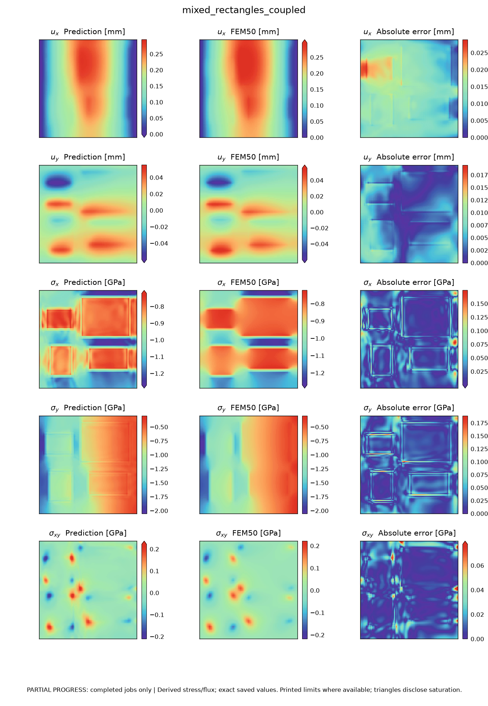


---

### 7. 사각형 동시 학습: 열 전체장

완료된 100,000회 실행의 예측, FEniCS50 기준해 및 절대 차이를 원문 색 범위로 표시한다. 응력과 열유속은 구성식/Fourier 미분 출력이다. 색 범위 밖 값은 색 막대의 삼각형으로 표시하며, 수치 배열을 범위에 맞추어 수정하지 않는다. FEM200 기준의 정량 오차는 본문과 부록 B에 별도로 제시한다.

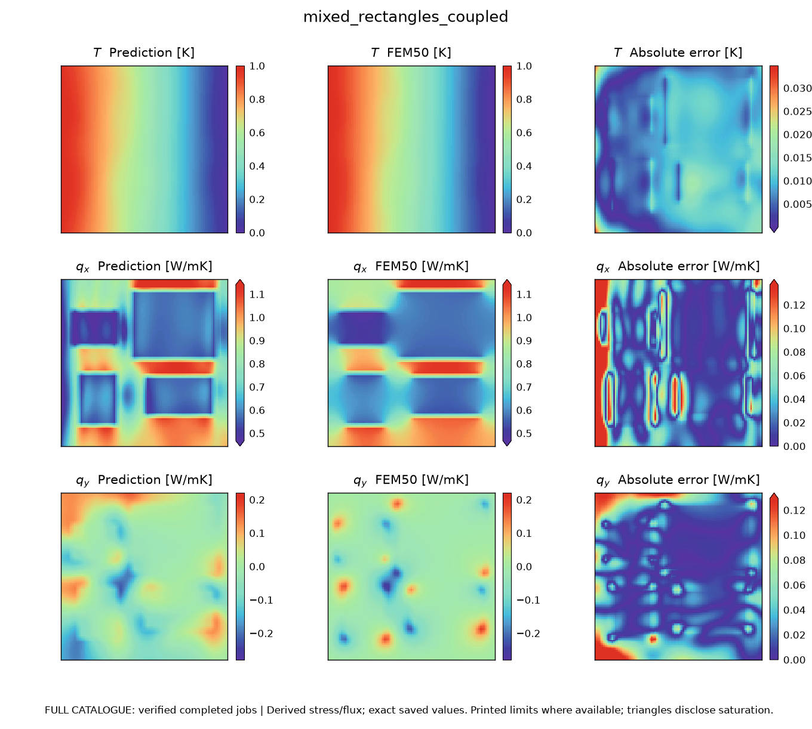


---

### 7. 사각형 동시 학습: 계산 과정

원래 CSV에 기록된 실제 손실 항을 표시한다. 이력의 진동을 평활화하지 않았으며, 손실 감소가 모든 성분의 오차 감소를 보장하지 않는다.

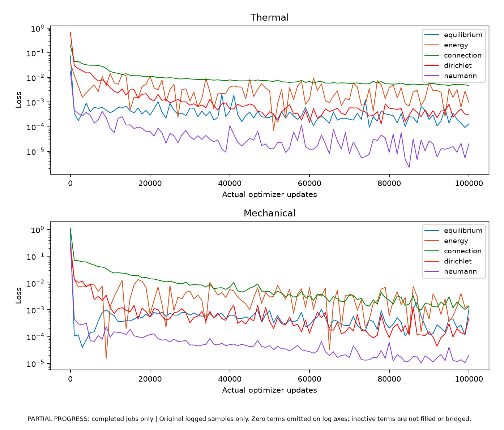


---

### 7. 원형 동시 학습: 역학 전체장

완료된 100,000회 실행의 예측, FEniCS50 기준해 및 절대 차이를 원문 색 범위로 표시한다. 응력과 열유속은 구성식/Fourier 미분 출력이다. 색 범위 밖 값은 색 막대의 삼각형으로 표시하며, 수치 배열을 범위에 맞추어 수정하지 않는다. FEM200 기준의 정량 오차는 본문과 부록 B에 별도로 제시한다.

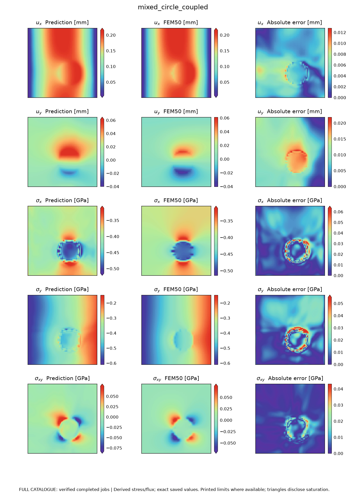


---

### 7. 원형 동시 학습: 열 전체장

완료된 100,000회 실행의 예측, FEniCS50 기준해 및 절대 차이를 원문 색 범위로 표시한다. 응력과 열유속은 구성식/Fourier 미분 출력이다. 색 범위 밖 값은 색 막대의 삼각형으로 표시하며, 수치 배열을 범위에 맞추어 수정하지 않는다. FEM200 기준의 정량 오차는 본문과 부록 B에 별도로 제시한다.

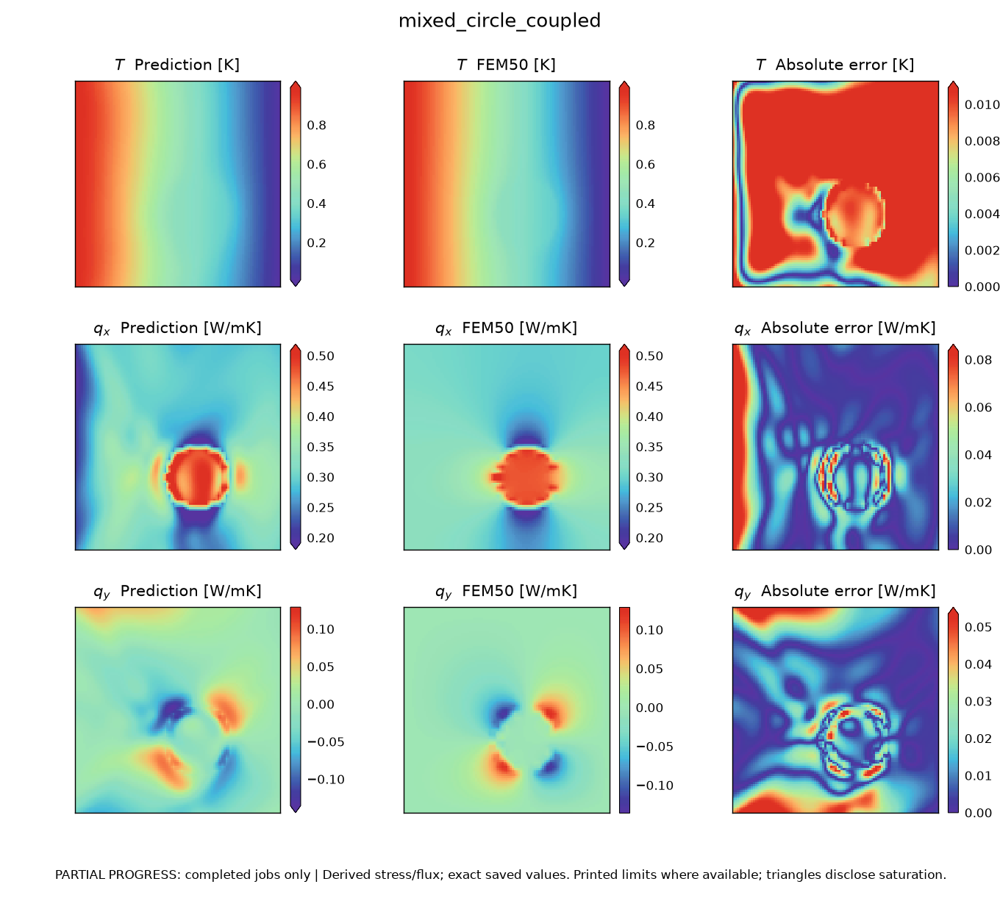


---

### 7. 원형 동시 학습: 계산 과정

원래 CSV에 기록된 실제 손실 항을 표시한다. 이력의 진동을 평활화하지 않았으며, 손실 감소가 모든 성분의 오차 감소를 보장하지 않는다.

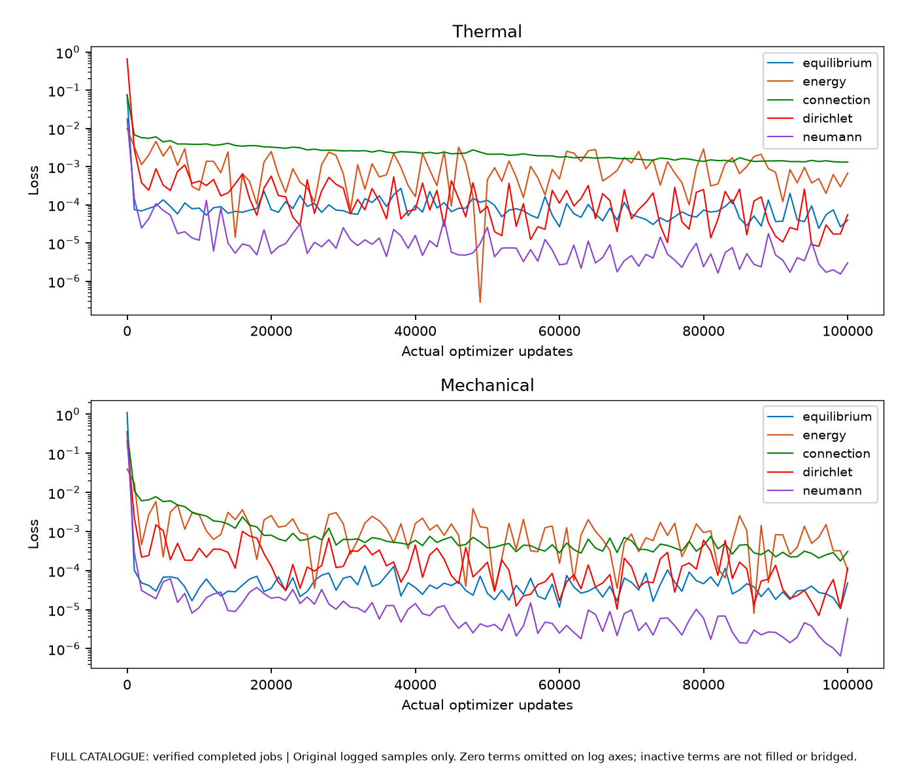


---

## 8. 왼쪽 경계 보강과 에너지 항 제외

두 학습 방식의 소프트 경계에서 남는 오차를 점검하고, 사각형 왼쪽에 약 1,000점을 추가한 실행과 기본 실행을 비교한다. 추가점은 점 평균 손실의 상대적인 가중도 바꿀 수 있으므로 단순히 공간 해상도만 높인 것으로 해석하지 않는다.

**표 15. 왼쪽 경계 보강과 에너지 항 제외**

| 실행 | 좌측 max|$`u_x`$| | 좌측 max|T-1| | 전체 법선 u | 전체 온도 DBC |
| --- | --- | --- | --- | --- |
| J01 | 0.02523 | 0.03152 | 0.02523 | 0.03152 |
| J02 | 0.01395 | 0.02388 | 0.01813 | 0.02388 |
| J11 | 0.01718 | 0.03382 | 0.0176 | 0.03382 |
| J13 | 0 | 0 | 0 | 0 |
| J20 | 0 | 0 | 0 | 0 |

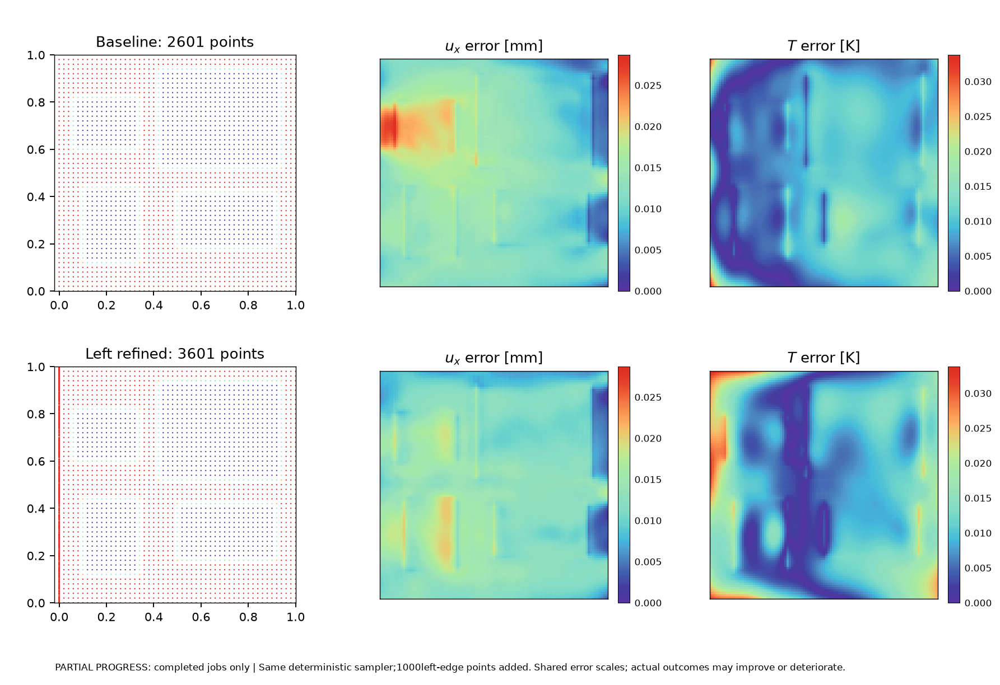

**표 16. 왼쪽 경계 보강과 에너지 항 제외**

| 성분 | J11 - J01 평균(pp) | 최대(pp) |
| --- | --- | --- |
| $`u_x`$ | -0.1901 | -2.635 |
| $`u_y`$ | -1.817 | -3.458 |
| $`\sigma_{xx}`$ | 0.1203 | 0.1097 |
| $`\sigma_{yy}`$ | -0.09812 | -0.4652 |
| $`\sigma_{xy}`$ | 0.3744 | 72.88 |
| T | 0.178 | 0.2302 |
| $`q_x`$ | 0.6931 | -5.561 |
| $`q_y`$ | 3.168 | 18.29 |

왼쪽 실행의 평균오차가 작은 성분은 3/8개, 최대오차가 작은 성분은 4/8개이다. 양의 변화는 악화, 음의 변화는 개선이다. 단일 시드 결과이며 통계적 우세나 모든 상황의 순위로 확대하지 않는다.

### 원형의 에너지 항 제외

원문은 학습 중 변화가 작은 에너지 항을 제거하였을 때 정확도가 저하되는 사례를 보고하였다. 이를 검토하기 위해 나머지 설정을 유지하고 에너지 항만 제외한 절제 실험을 구성하였다. 효과의 방향과 크기는 기본 실행 대비 성분별 오차 변화로 평가한다. 이는 손실 항의 변화량과 최종 예측 정확도의 관계를 확인하기 위한 실험이다.

**표 17. 원형의 에너지 항 제외**

| 성분 | J12 - J03 평균(pp) | 최대(pp) |
| --- | --- | --- |
| $`u_x`$ | -1.189 | -1.115 |
| $`u_y`$ | -16.26 | -25.37 |
| $`\sigma_{xx}`$ | -1.735 | 24.45 |
| $`\sigma_{yy}`$ | -1.515 | -1.411 |
| $`\sigma_{xy}`$ | -1.767 | 66.59 |
| T | -1.042 | -1.662 |
| $`q_x`$ | -2.794 | -2.801 |
| $`q_y`$ | -7.479 | -17.05 |

왼쪽 실행의 평균오차가 작은 성분은 8/8개, 최대오차가 작은 성분은 6/8개이다. 양의 변화는 악화, 음의 변화는 개선이다. 단일 시드 결과이며 통계적 우세나 모든 상황의 순위로 확대하지 않는다.


---

## 9. 하드 경계·최적화기·1M 연속 실행

강제 경계조건은 다음 출력 변환으로 부과한다. 원문의 $`x(x-1)`$ 표현과 부호 차이는 기저 신경망에 흡수될 수 있지만 초기화 궤적까지 같음을 보장하지 않는다. 정확히 0인 경계 오차를 로그 축에서 임의의 양수로 바꾸지 않는다.

```math
u_x=x(1-x)N_{u_x},\qquad u_y=y(1-y)N_{u_y},\qquad T=1-x+x(1-x)N_T
\tag{9}
```

**표 18. 하드 경계·최적화기·1M 연속 실행**

| 실행 | $`u_x`$ | $`\sigma_{xx}`$ | T | $`q_x`$ |
| --- | --- | --- | --- | --- |
| J13 | 1.011 | 3.733 | 1.048 | 6.866 |
| J20 | 2.661 | 7.991 | 1.962 | 8.284 |

표의 값은 평균 절대오차/기준해 최대 절댓값(%)이다. 일반 실행 FEM200, 비율 15는 별도 FEM50을 기준으로 하며, 구성식/Fourier 출력을 사용한다. 전체 8성분·직접 출력은 부록 B에 있다.

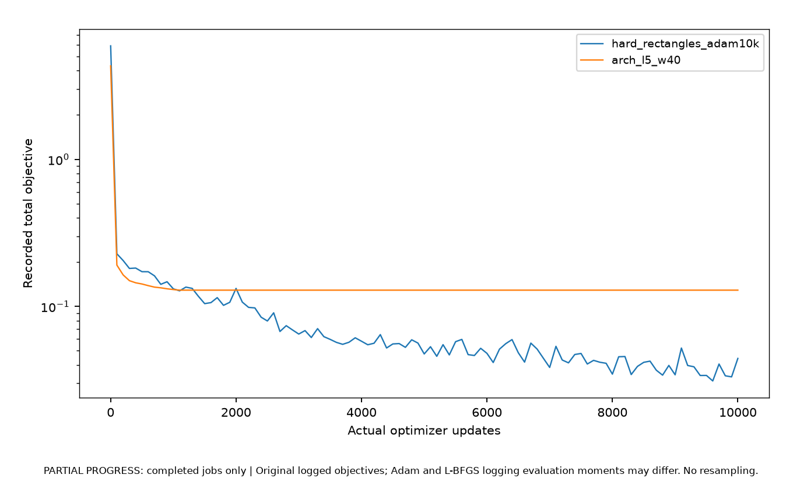

하드 두 실행은 각각 10k이지만 소프트 기본 Adam은 100k이다. 따라서 소프트/하드 결과 차이를 경계조건 하나의 인과 효과로 부르지 않는다. Adam과 L-BFGS는 목적함수 평가 횟수와 벽시계 시간까지 함께 확인한다.

### Remark 7의 1M 문구

Table 1의 100k와 Remark 7의 1M이 충돌하므로 사각형 100k 체크포인트를 보존하고 같은 궤적에 900k를 추가한 별도 실행을 둔다. 원문의 원래 시드·하드/소프트·실행 동일성은 확인되지 않으므로 이 추가 실행은 명시적인 재구성이다. 1M 실행으로 100k 결과를 덮어쓰지 않는다.

**표 19. Remark 7의 1M 문구**

| 실행 | $`u_x`$ | $`\sigma_{xx}`$ | T | $`q_x`$ |
| --- | --- | --- | --- | --- |
| J01 | 4.325 | 2.202 | 0.8511 | 3.684 |

표의 값은 평균 절대오차/기준해 최대 절댓값(%)이다. 일반 실행 FEM200, 비율 15는 별도 FEM50을 기준으로 하며, 구성식/Fourier 출력을 사용한다. 전체 8성분·직접 출력은 부록 B에 있다.

비교 대기: J52 대 J01. 두 실행이 모두 완료·평가되기 전에는 개선 여부를 결론내리지 않는다.

그림 대기: 그림 6. 100k와 1M의 기록된 누적 시간·업데이트 비교. 연속 실행의 재사용 예산을 이중 계산하지 않는다. 완료 실행과 기준해가 준비되면 추가된다.


---

## 10. 신경망 구조의 정확도

깊이 연구는 너비 40을 고정한 1,2,4,5,6층이며, 너비 연구는 5층에서 5,10,20,40,60 뉴런이다. 모두 하드 경계의 동시 L-BFGS 10k이다. 겹치는 5$`\times`$40은 동일 실행을 재사용한다. 3층은 원문의 실험값이 아니므로 임의로 추가하지 않는다.

**표 20. 신경망 구조의 정확도**

| 실행 | $`u_x`$ | $`\sigma_{xx}`$ | T | $`q_x`$ |
| --- | --- | --- | --- | --- |
| J14 | 12.58 | 18.84 | 3.992 | 16.74 |
| J15 | 2.04 | 8.711 | 1.528 | 8.633 |
| J16 | 2.194 | 8.483 | 1.048 | 8.215 |
| J17 | 3.819 | 12.49 | 2.055 | 11.9 |
| J18 | 5.108 | 13.82 | 2.968 | 14.07 |
| J19 | 15.32 | 21.43 | 5.751 | 16.37 |
| J20 | 2.661 | 7.991 | 1.962 | 8.284 |
| J21 | 2.788 | 9.549 | 2.005 | 10.4 |
| J22 | 6.149 | 14.24 | 3.124 | 13.38 |

표의 값은 평균 절대오차/기준해 최대 절댓값(%)이다. 일반 실행 FEM200, 비율 15는 별도 FEM50을 기준으로 하며, 구성식/Fourier 출력을 사용한다. 전체 8성분·직접 출력은 부록 B에 있다.

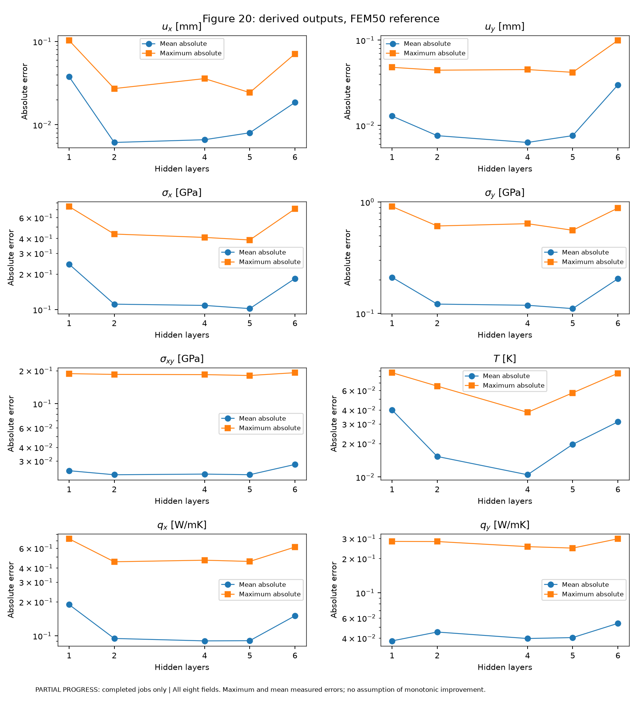

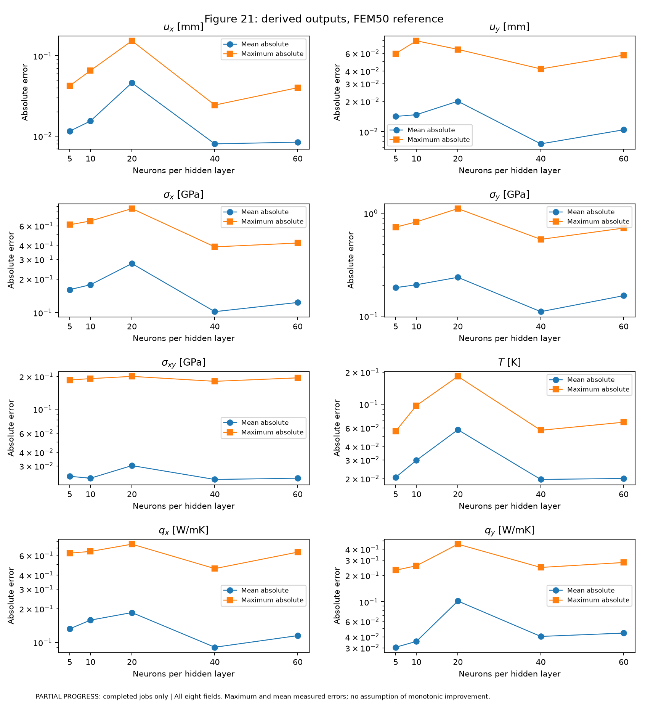

원문에서는 5개 은닉층을 갖는 구조가 전반적으로 양호한 성능을 보이나, $`\sigma_{xx}`$의 최대오차에는 예외가 제시되어 있다. 본 연구에서는 평균오차와 최대오차를 함께 비교하여 이러한 경향을 검토한다. 최대오차는 재료 경계의 위치, 응력 복원 방식 및 평가 격자에 민감하므로 단일 지표만으로 구조의 적합성을 판단하기 어렵다.

**표 21. 신경망 구조의 정확도**

| 성분 | J20 - J16 평균(pp) | 최대(pp) |
| --- | --- | --- |
| $`u_x`$ | 0.4672 | -3.787 |
| $`u_y`$ | 2.095 | -5.275 |
| $`\sigma_{xx}`$ | -0.4921 | -0.144 |
| $`\sigma_{yy}`$ | -0.3875 | -2.405 |
| $`\sigma_{xy}`$ | -0.07886 | -1.427 |
| T | 0.9142 | 1.883 |
| $`q_x`$ | 0.06916 | -1.027 |
| $`q_y`$ | 0.1932 | -1.891 |

왼쪽 실행의 평균오차가 작은 성분은 3/8개, 최대오차가 작은 성분은 7/8개이다. 양의 변화는 악화, 음의 변화는 개선이다. 단일 시드 결과이며 통계적 우세나 모든 상황의 순위로 확대하지 않는다.

실제 FEM200 비교에서 4층·40뉴런의 온도 상대 $`L^2`$ 오차는 2.22%, 5층·40뉴런은 3.95%이다. 반면 수평 정상응력 오차는 14.65%에서 13.73%로 감소한다. 동일한 층수 증가가 물리량에 따라 다른 결과를 보인다.

5층에서 20·40·60뉴런의 수평변위 상대 $`L^2`$ 오차는 각각 33.34%, 5.32%, 5.75%이다. 고정된 L-BFGS 예산과 단일 시드에서 오차는 네트워크 크기에 대해 단조 감소하지 않는다. 이를 표현 능력만의 효과로 해석할 수 없으며, 최적화 정체와 초기값의 영향은 별도 시드 반복과 수렴 검사를 통해 구분해야 한다.


---

## 11. Table 4 시간 측정과 실행 환경

25개 조합은 각 100 L-BFGS 업데이트를 다른 연구 작업과 겹치지 않게 실행한다. 지표는 원본 이력의 정확한 update=100 누적 시간/100이다. 초기 설정·closure·로그·체크포인트 오버헤드를 포함한 벽시계 시간이며 순수 GPU 커널 시간은 아니다. 여러 작업 동시 실행의 시간으로 이를 대체하지 않는다.

**표 22. Table 4 시간 측정과 실행 환경**

| 층 / 뉴런 | 5 | 10 | 20 | 40 | 60 |
| --- | --- | --- | --- | --- | --- |
| 1 | - | - | - | - | - |
| 2 | - | - | - | - | - |
| 4 | - | - | - | - | - |
| 5 | - | - | - | - | - |
| 6 | - | - | - | - | - |

단위는 s/update이다. 빈칸(-)은 검증 완료의 정확한 100회 측정값이 아직 없다는 뜻이며 0초가 아니다.

**표 23. Table 4 시간 측정과 실행 환경**

| Python / torch | 장치 | 기록 파일 |
| --- | --- | --- |
| 3.11.9 / 2.11.0+cu128 | NVIDIA GeForce RTX 3090 | results\`full_study`\`mixed_rectangles_coupled`\`environment.json` |

환경 파일은 진행 중 실행에도 존재할 수 있으므로 이 표 자체는 완료의 증거가 아니다. 원문 시간은 Apple M2 Pro이며 로컬 GPU·운영체제·라이브러리가 다르다. Table 4의 5$`\times`$40 0.3409초를 10k에 곱하면 약 56.8분으로, 본문의 약 40분과도 차이가 있다. 논문 시간을 로컬 종료 보장값으로 사용하지 않는다.

### 효율에 관한 결론의 제한

최적화기 비교에는 실제 정확도, 업데이트 및 closure 수, 전처리/평가 포함 범위를 함께 명시해야 한다. 시간만 줄었다고 방법이 우수하다고 결론내리지 않는다. 재시작으로 누적된 시간과 연속 실행의 재사용 예산도 구분한다.


---

## 12. 재료비 전이학습의 설계

그림 22의 명시적 정의에 따라 E기지/E개재물=k기지/k개재물=r이다. 기지 E=k=1, 개재물 E=k=1/r로 둔다. r=1,...,10을 순서대로 학습하고 각 비율에 10k Adam을 배분한다. 총 100k 업데이트 후 최종 가중치로 r=15를 평가한다. 두 재료비는 이 연구에서 항상 같으므로 독립 E비율·k비율 일반화를 검증한 것으로 해석하지 않는다.

입력은 x,y와 전역 log10 재료비 두 개이다. 같은 기지 좌표에서 국소 E,k가 같아도 전체 BVP는 달라지므로 전역 비율이 문제를 식별한다. 국소 E(x,y),k(x,y)를 말하는 본문과 이 인코딩 선택의 차이를 공개한다.

```math
\mathcal L_{\mathrm{total}}=\mathcal L_{\mathrm{data}}+w\!\left(\mathcal L_{\mathrm T}+\mathcal L_{\mathrm M}\right)
\tag{10}
```

**표 24. 재료비 전이학습의 설계**

| 실행 | w | 경계 | 데이터 정규화 | 총 업데이트 |
| --- | --- | --- | --- | --- |
| J23 | 0.0 | soft | none | 100000 |
| J24 | 0.1 | soft | none | 100000 |
| J25 | 0.5 | soft | none | 100000 |
| J26 | 1.0 | soft | none | 100000 |

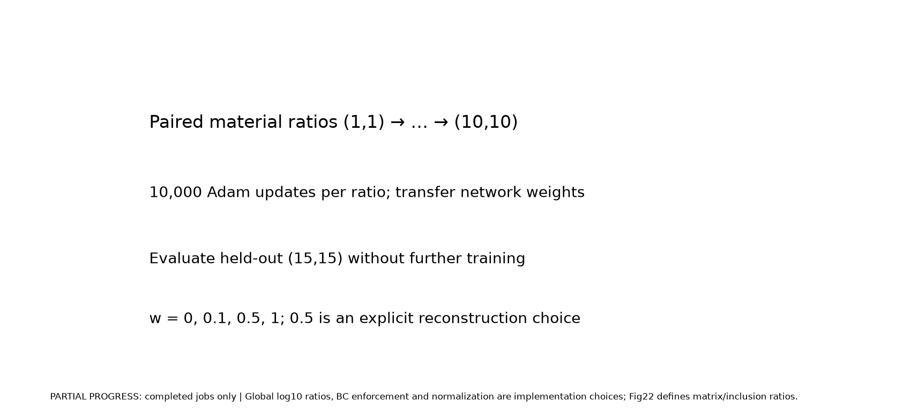

각 비율의 Adam 상태는 새로 시작하고 모델 가중치를 전달한다. 비율 내부 재시작은 Adam 상태를 보존한다. 원시 8성분 MSE의 단위별 규모와 physics 손실의 상대 크기는 가중치 효과에 영향을 준다. 다른 정규화로 얻은 w=0.1과 같은 의미의 가중치라고 가정하지 않는다.

테스트 비율 15는 마지막 학습까지 라벨을 읽지 않고, 조기 종료·최적 체크포인트·가중치 선택에 쓰지 않는다. 네 사전 고정 가중치의 테스트 비교를 공개하되 이 결과로 다시 선택한 가중치를 독립 검증 최적값이라고 부르지 않는다.


---

## 13. 미학습 비율 15의 실제 결과

**표 25. 미학습 비율 15의 실제 결과**

| 실행 | $`u_x`$ | $`\sigma_{xx}`$ | T | $`q_x`$ |
| --- | --- | --- | --- | --- |
| J23 | 5.231 | 22.78 | 1.105 | 5.388 |
| J24 | 4.503 | 15.03 | 1.342 | 3.62 |
| J25 | 3.351 | 14.93 | 1.435 | 3.913 |
| J26 | 3.98 | 14.75 | 1.483 | 4.826 |

표의 값은 평균 절대오차/기준해 최대 절댓값(%)이다. 일반 실행 FEM200, 비율 15는 별도 FEM50을 기준으로 하며, 구성식/Fourier 출력을 사용한다. 전체 8성분·직접 출력은 부록 B에 있다.

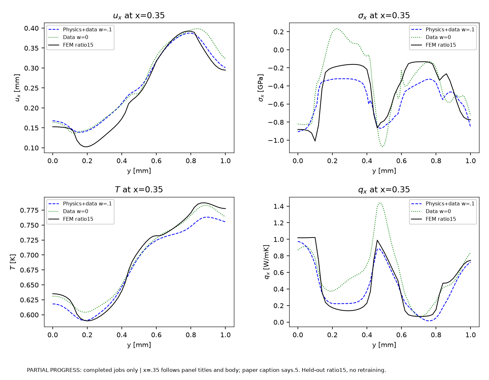

### 물리 항의 개선과 반례를 함께 검사

**표 26. 물리 항의 개선과 반례를 함께 검사**

| 성분 | J24 - J23 평균(pp) | 최대(pp) |
| --- | --- | --- |
| $`u_x`$ | -0.7287 | -6.8 |
| $`u_y`$ | -1.226 | -7.127 |
| $`\sigma_{xx}`$ | -7.75 | -56.22 |
| $`\sigma_{yy}`$ | -4.851 | -50.66 |
| $`\sigma_{xy}`$ | -2.221 | -66.84 |
| T | 0.2373 | 5.439 |
| $`q_x`$ | -1.768 | -22.19 |
| $`q_y`$ | 0.4607 | 12.43 |

왼쪽 실행의 평균오차가 작은 성분은 6/8개, 최대오차가 작은 성분은 6/8개이다. 양의 변화는 악화, 음의 변화는 개선이다. 단일 시드 결과이며 통계적 우세나 모든 상황의 순위로 확대하지 않는다.

원문의 전이학습 결과에서는 물리 손실을 추가하였을 때 여러 성분의 오차가 감소하는 반면, $`q_x`$의 최대오차는 일부 위치에서 증가하는 예외가 나타난다. 이에 따라 본 연구는 평균오차와 최대오차의 변화량을 각각 산정한다. 음의 변화량은 개선, 양의 변화량은 악화를 의미하며, 그 부호를 통해 물리 손실의 이점과 국소적인 한계를 함께 평가한다.

이번 계산에서 w=0.1은 데이터만 사용한 w=0에 비해 평균 정규화오차가 T, $`q_y`$에서, 최대 정규화오차가 T, $`q_y`$에서 증가하였다. 원문의 예외 성분과 로컬 계산의 악화 성분을 구분해야 한다.

수평 열유속 $`q_x`$의 최대 정규화오차 변화는 -22.19 pp이다. 이 비교에서는 $`q_x`$ 최대오차가 감소했으므로 원문의 $`q_x`$ 최대오차 악화 사례가 같은 형태로 재현되었다고 할 수 없다. 온도 상대 $`L^2`$ 오차는 2.08%에서 3.02%로 변하였다. 물리 항이 모든 성분의 일반화 오차를 줄인다는 결론은 지지되지 않는다.

w=0.1의 수평 정상응력 상대 $`L^2`$ 오차는 69.56%로 여전히 크다. 일부 성분의 개선을 미학습 재료비의 정밀 재현으로 해석하지 않으며, 전체장·직접 출력·구성식 출력의 차이를 함께 확인한다.

**표 27. 물리 항의 개선과 반례를 함께 검사**

| 측정 | 값 |
| --- | --- |
| w=0 학습초 | 1258 |
| w=0.1 학습초 | 3714 |
| 1-t(w=0)/t(w=0.1) | 66.12% |

기록된 학습 시간으로 계산한 데이터 전용 실행의 비용 감소율은 66.12%이다. 실행별 누적 벽시계 시간에 대한 관측값이며, 독립 반복 시간 측정이나 원문 장비에서의 비용 비율을 대신하지 않는다.


---

### 13.1 미학습 재료비의 전체장과 국소 오차

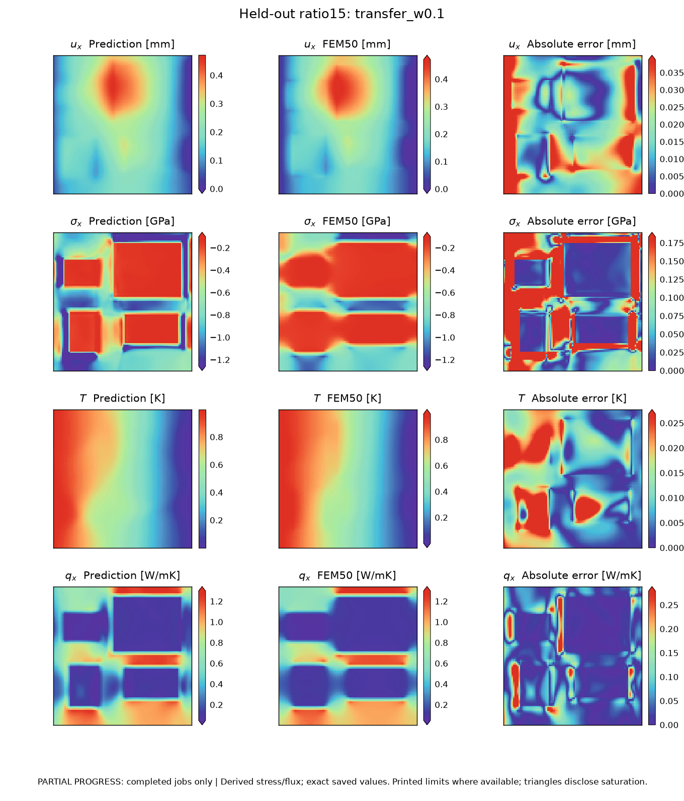


---

### 13.2 데이터 전용 모델의 동일 기준 비교

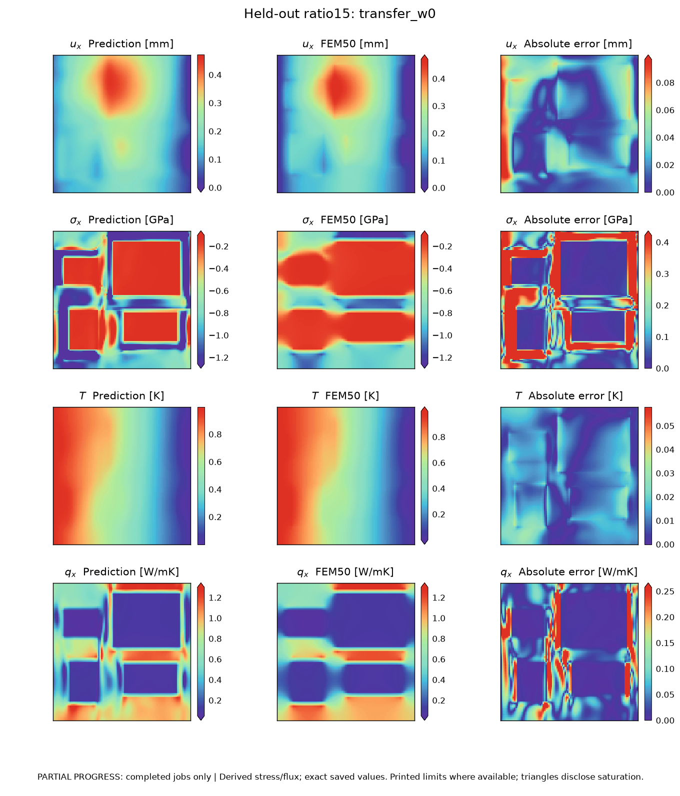


---

## 14. FEM 격자 수렴과 해석 한계

**표 28. FEM 격자 수렴과 해석 한계**

| 기하/요소 | $`u_x`$ | $`u_y`$ | $`\sigma_{xx}`$ | $`\sigma_{yy}`$ | $`\sigma_{xy}`$ | T | $`q_x`$ | $`q_y`$ |
| --- | --- | --- | --- | --- | --- | --- | --- | --- |
| circle 50 | 0.432 | 3.7 | 1.64 | 1.27 | 22.1 | 0.118 | 3.17 | 23.3 |
| circle 100 | 0.217 | 1.59 | 0.988 | 0.755 | 11 | 0.0649 | 1.78 | 11.7 |
| rectangles 50 | 0.0524 | 0.444 | 2.69 | 2.76 | 13.9 | 0.0101 | 4.13 | 14.1 |
| rectangles 100 | 0.00662 | 0.0614 | 0.156 | 0.169 | 5.2 | 0.00122 | 0.128 | 4.82 |

표는 200$`\times`$200 대비 상대 $`L^2`$(%)를 NPZ에서 새로 계산했다. 기준이 0인 분모는 빈값이다. 해법 잔차와 격자 수렴은 서로 다른 검증이다.

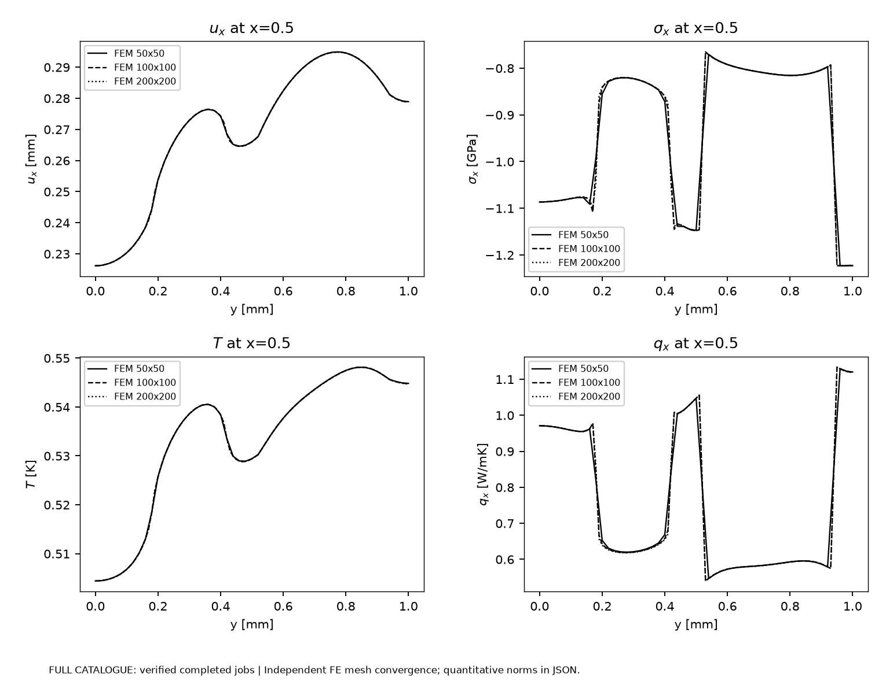

응력·열유속은 재료 경계에서 불연속일 수 있고 연속 절점 복원에 의존한다. 따라서 작은 평균오차와 큰 국소 최대오차가 동시에 나타날 수 있다. 원문의 “100에서 거의 수렴”에는 정량 허용오차가 없으므로 본 표의 변화를 보고 판단한다.


---

## 15. 결론

현재 26개 신경망 실행의 예측 배열과 기준해를 정렬하여 오차를 다시 계산했다. 각 절의 표와 변화량은 실제 완료 결과에 한정된다. 개선 성분과 악화 성분을 모두 남기며, 아래 제한 없이 보편적인 방법 순위로 확대하지 않는다.

**표 29. 주 혼합 PINN의 상대 $`L^2`$ 오차 요약(FEM200 기준)**

| 기하 | 학습 방식 | 수평변위 오차 (%) | 온도 오차 (%) |
| --- | --- | --- | --- |
| 원형 | 동시 | 2.86 | 2.34 |
| 원형 | 순차 | 4.78 | 2.31 |
| 사각형 | 동시 | 7.23 | 1.58 |
| 사각형 | 순차 | 4.22 | 1.25 |

위 결과는 순차 학습의 효과가 기하와 평가 성분에 의존함을 보여준다. 따라서 학습 방법의 선택에는 전체 목적함수의 감소뿐 아니라 변위·응력·온도·열유속의 오차와 경계조건의 만족도를 함께 고려해야 한다. 연성 경계조건의 에너지 최소화에서는 페널티 자체가 유발하는 편향도 별도로 평가할 필요가 있다.

확장된 구조 연구와 전이학습에서도 개선은 성분별로 달랐다. 네트워크 깊이·너비의 증가가 단조 개선을 보장하지 않았고, 물리·데이터 결합은 일부 변위·응력·열유속을 개선하면서 온도 및 수직 열유속을 악화시켰다. 따라서 원문의 특정 최적 구조나 예외 성분을 이 구현에 그대로 일반화할 수 없다.

### 15.1 적용 범위와 후속 검증

첫째, 단일 시드와 지정 기하·하중·재료비에 대한 결과이므로 표본 변동이나 다른 문제에 대한 일반화를 확정하지 않는다. 둘째, 소프트 페널티·에너지·재료 미분·학습 배치·옵티마이저 상태 정책은 비교의 의미를 바꾼다. 셋째, 원문의 미기재 설정과 도해/본문 충돌 때문에 완전한 동일 실험의 유일한 해석은 존재하지 않는다.

넷째, 비율 15의 성공은 새로운 미세구조·다른 경계조건·독립 두 재료비의 일반화를 입증하지 않는다. 다섯째, 원문 시각 형식과 색 범위를 맞춘 것은 수치해를 맞춘 것과 다르다. 포화 색 영역은 감사표로 드러내고 예측 배열은 그대로 둔다. 여섯째, 장기 궤적과 실제 장비 시간이 원문과 다른 것은 소프트웨어·장비·재구성 차이를 함께 검토해야 한다.

### 15.2 계산 자료의 재사용

`notebooks/Full_Paper_Reproduction_KO.ipynb`는 완료·대기 상태, 독립 FEM/PINN 검증, NPZ 오차 재계산 및 편집 가능한 그림을 제공한다. 기본값은 전체 학습을 시작하지 않고 완료된 자료만 읽는다. `RUN_FULL_STUDY`=True는 누락 FEM과 신경망 전체를 실행한 뒤 시간 연구를 단독 실행한다. 동일 설정의 체크포인트는 이어서 계산한다.

명령행: python -m harandi.`full_study` --groups mixed baseline transfer --workers 1
이후: python -m harandi.`full_study` --groups timing --workers 1
그림: python -m harandi.`full_figures`
보고서: python `scripts/build_full_korean_report.py` --pinn-python `PROJECT_PYTHON`

중간 상태만 공유할 때는 그림과 보고서에 --partial을 명시한다. 새로운 조건은 별도 폴더에 저장하고 기존 결과를 바꾸어 재현 성공처럼 보이게 하지 않는다. 원본 로그를 완만하게 보간하거나 기록되지 않은 비활성 손실을 0으로 채우지 않는다.


---

## 참고문헌

Harandi, A., Moeineddin, A., Kaliske, M., Reese, S., Rezaei, S. (2024). Mixed formulation of physics-informed neural networks for thermo-mechanically coupled systems and heterogeneous domains. International Journal for Numerical Methods in Engineering, 125(4), e7388. [https://doi.org/10.1002/nme.7388](https://doi.org/10.1002/nme.7388). 온라인 선게재 연도는 2023년이다.

phyml4e. PINNs: 저자 공개 구현 및 벤치마크 자료. [https://github.com/phyml4e/PINNs](https://github.com/phyml4e/PINNs). 사용 커밋과 파일 해시는 `docs/SOURCE_PROVENANCE.json`에 기록하였다.

### 국문 서술 및 편집 형식 참고

아래 자료는 국·영문 제목과 초록, 용어의 최초 정의, 번호가 부여된 수식·표·그림, 결과와 해석을 연결하는 문단 구성에 참고하였다. 본 연구의 수치 결과는 자체 계산에서 얻었으며, 아래 논문의 계산 결과를 검증 자료로 사용하지 않았다. 학술지의 저자·소속·게재 정보나 편집 서식을 그대로 재현하지 않았다.

한국전산구조공학회. 논문 작성 및 투고 지침, 3절 원고 작성 요령. [학회 공식 작성 지침](https://www.jcoseik.or.kr/journal-information/instructions-for-authors/). 확인일: 2026-11-04.

신호철, 이재훈 (2026). 선형 동적 시스템의 주파수 응답 해석을 위한 심층 연산자 네트워크 기반 예측 알고리즘 응용. 한국전산구조공학회논문집, 39(4), 265-272. [https://doi.org/10.7734/COSEIK.2026.39.4.265](https://doi.org/10.7734/COSEIK.2026.39.4.265).

김준식 (2026). 변분 사영 관점에서 본 공회전 및 내재적 보 이론의 비선형 구조. 한국전산구조공학회논문집, 39(4), 219-228. [https://doi.org/10.7734/COSEIK.2026.39.4.219](https://doi.org/10.7734/COSEIK.2026.39.4.219).


---

## 부록 A. 모든 작업의 예산과 완료·대기 상태

J 코드는 본 보고서의 표에서 사용하는 실행 식별자이다. 현재 catalogue 순서에 대응하며 원문의 독립 실험 번호는 아니다. 요구 업데이트는 열·역학의 실제 갱신을 합친 수이다. 시간 연구는 정확도 연구와 구분한다.

**표 30. 부록 A. 모든 작업의 예산과 완료·대기 상태**

| 코드 | 실행 ID | 구조·경계·최적화 | 실제 / 요구 | 상태 |
| --- | --- | --- | --- | --- |
| J01 | `mixed_rectangles_coupled` | 5$`\times`$40 / soft / Adam | 100000 / 100,000 | 검증 완료 |
| J02 | `mixed_rectangles_sequential` | 5$`\times`$40 / soft / Adam | 200000 / 200,000 | 검증 완료 |
| J03 | `mixed_circle_coupled` | 5$`\times`$40 / soft / Adam | 100000 / 100,000 | 검증 완료 |
| J04 | `mixed_circle_sequential` | 5$`\times`$40 / soft / Adam | 200000 / 200,000 | 검증 완료 |
| J05 | `baseline_circle_standard_coupled` | 5$`\times`$40 / soft / Adam | 100000 / 100,000 | 검증 완료 |
| J06 | `baseline_circle_standard_sequential` | 5$`\times`$40 / soft / Adam | 200000 / 200,000 | 검증 완료 |
| J07 | `baseline_circle_dem_coupled` | 5$`\times`$40 / soft / Adam | 100000 / 100,000 | 검증 완료 |
| J08 | `baseline_circle_dem_sequential` | 5$`\times`$40 / soft / Adam | 200000 / 200,000 | 검증 완료 |
| J09 | `sensitivity_circle_dem_hard_coupled` | 5$`\times`$40 / hard / Adam | 100000 / 100,000 | 검증 완료 |
| J10 | `sensitivity_circle_dem_hard_sequential` | 5$`\times`$40 / hard / Adam | 200000 / 200,000 | 검증 완료 |
| J11 | `refine_rectangles_left1000` | 5$`\times`$40 / soft / Adam | 100000 / 100,000 | 검증 완료 |
| J12 | `ablation_circle_noenergy` | 5$`\times`$40 / soft / Adam | 100000 / 100,000 | 검증 완료 |
| J13 | `hard_rectangles_adam10k` | 5$`\times`$40 / hard / Adam | 10000 / 10,000 | 검증 완료 |
| J14 | `arch_l1_w40` | 1$`\times`$40 / hard / L-BFGS | 10000 / 10,000 | 검증 완료 |
| J15 | `arch_l2_w40` | 2$`\times`$40 / hard / L-BFGS | 10000 / 10,000 | 검증 완료 |
| J16 | `arch_l4_w40` | 4$`\times`$40 / hard / L-BFGS | 10000 / 10,000 | 검증 완료 |
| J17 | `arch_l5_w5` | 5$`\times`$5 / hard / L-BFGS | 10000 / 10,000 | 검증 완료 |
| J18 | `arch_l5_w10` | 5$`\times`$10 / hard / L-BFGS | 10000 / 10,000 | 검증 완료 |
| J19 | `arch_l5_w20` | 5$`\times`$20 / hard / L-BFGS | 10000 / 10,000 | 검증 완료 |
| J20 | `arch_l5_w40` | 5$`\times`$40 / hard / L-BFGS | 10000 / 10,000 | 검증 완료 |
| J21 | `arch_l5_w60` | 5$`\times`$60 / hard / L-BFGS | 10000 / 10,000 | 검증 완료 |
| J22 | `arch_l6_w40` | 6$`\times`$40 / hard / L-BFGS | 10000 / 10,000 | 검증 완료 |
| J23 | `transfer_w0` | 5$`\times`$40 / soft / Adam | 100000 / 100,000 | 검증 완료 |
| J24 | `transfer_w0`.1 | 5$`\times`$40 / soft / Adam | 100000 / 100,000 | 검증 완료 |
| J25 | `transfer_w0`.5 | 5$`\times`$40 / soft / Adam | 100000 / 100,000 | 검증 완료 |
| J26 | `transfer_w1` | 5$`\times`$40 / soft / Adam | 100000 / 100,000 | 검증 완료 |
| J27 | `timing_l1_w5` | 1$`\times`$5 / hard / L-BFGS | - / 100 | 대기 |
| J28 | `timing_l1_w10` | 1$`\times`$10 / hard / L-BFGS | - / 100 | 대기 |
| J29 | `timing_l1_w20` | 1$`\times`$20 / hard / L-BFGS | - / 100 | 대기 |
| J30 | `timing_l1_w40` | 1$`\times`$40 / hard / L-BFGS | - / 100 | 대기 |
| J31 | `timing_l1_w60` | 1$`\times`$60 / hard / L-BFGS | - / 100 | 대기 |
| J32 | `timing_l2_w5` | 2$`\times`$5 / hard / L-BFGS | - / 100 | 대기 |
| J33 | `timing_l2_w10` | 2$`\times`$10 / hard / L-BFGS | - / 100 | 대기 |
| J34 | `timing_l2_w20` | 2$`\times`$20 / hard / L-BFGS | - / 100 | 대기 |
| J35 | `timing_l2_w40` | 2$`\times`$40 / hard / L-BFGS | - / 100 | 대기 |
| J36 | `timing_l2_w60` | 2$`\times`$60 / hard / L-BFGS | - / 100 | 대기 |
| J37 | `timing_l4_w5` | 4$`\times`$5 / hard / L-BFGS | - / 100 | 대기 |
| J38 | `timing_l4_w10` | 4$`\times`$10 / hard / L-BFGS | - / 100 | 대기 |
| J39 | `timing_l4_w20` | 4$`\times`$20 / hard / L-BFGS | - / 100 | 대기 |
| J40 | `timing_l4_w40` | 4$`\times`$40 / hard / L-BFGS | - / 100 | 대기 |
| J41 | `timing_l4_w60` | 4$`\times`$60 / hard / L-BFGS | - / 100 | 대기 |
| J42 | `timing_l5_w5` | 5$`\times`$5 / hard / L-BFGS | - / 100 | 대기 |
| J43 | `timing_l5_w10` | 5$`\times`$10 / hard / L-BFGS | - / 100 | 대기 |
| J44 | `timing_l5_w20` | 5$`\times`$20 / hard / L-BFGS | - / 100 | 대기 |
| J45 | `timing_l5_w40` | 5$`\times`$40 / hard / L-BFGS | - / 100 | 대기 |
| J46 | `timing_l5_w60` | 5$`\times`$60 / hard / L-BFGS | - / 100 | 대기 |
| J47 | `timing_l6_w5` | 6$`\times`$5 / hard / L-BFGS | - / 100 | 대기 |
| J48 | `timing_l6_w10` | 6$`\times`$10 / hard / L-BFGS | - / 100 | 대기 |
| J49 | `timing_l6_w20` | 6$`\times`$20 / hard / L-BFGS | - / 100 | 대기 |
| J50 | `timing_l6_w40` | 6$`\times`$40 / hard / L-BFGS | - / 100 | 대기 |
| J51 | `timing_l6_w60` | 6$`\times`$60 / hard / L-BFGS | - / 100 | 대기 |
| J52 | `remark_rectangles_adam1m` | 5$`\times`$40 / soft / Adam | - / 1,000,000 | 로컬 학습 중 |

로컬 학습 중 표시는 공개 자료 갱신 때 관측한 상태이다. 공개본에는 해당 실행의 중간 모델을 포함하지 않아 실제 횟수는 빈값으로 남긴다. 최종 결과 표는 검증 완료 실행만 사용한다.


---

## 부록 B. 전체 8성분 오차

다음 값은 보고서 생성 때 NPZ 배열에서 다시 계산한다. 일반 실행은 FEM200, 전이학습은 재료비 15의 FEM50을 기준으로 한다. $`\sigma_{xx}`$,$`\sigma_{yy}`$,$`\sigma_{xy}`$는 $`\sigma_{xx}`$,$`\sigma_{yy}`$,$`\sigma_{xy}`$로 표기한다. 변위·응력·온도·열유속은 각각 원문 벤치마크의 mm,GPa,K,W/mK 표기이며 혼합된 단위를 합산하여 하나의 정확도 점수로 만들지 않는다.

### 직접 출력 - 상대 $`L^2`$ (%)

**표 31. 직접 출력 - 상대 $`L^2`$ (%)**

| 실행 | $`u_x`$ | $`u_y`$ | $`\sigma_{xx}`$ | $`\sigma_{yy}`$ | $`\sigma_{xy}`$ | T | $`q_x`$ | $`q_y`$ |
| --- | --- | --- | --- | --- | --- | --- | --- | --- |
| J01 | 7.23 | 21 | 3.37 | 3.1 | 32.9 | 1.58 | 5.14 | 50.3 |
| J02 | 4.22 | 37 | 3.46 | 3.42 | 34.6 | 1.25 | 5.87 | 47.8 |
| J03 | 2.86 | 76.5 | 4.21 | 3.55 | 37.8 | 2.34 | 3.54 | 28.1 |
| J04 | 4.78 | 16.5 | 4.14 | 3.75 | 29.9 | 2.31 | 3.56 | 28.1 |
| J05 | 40.3 | 147 | 56.1 | 51.1 | 152 | 42.4 | 84.3 | 427 |
| J06 | 22.2 | 484 | 22.1 | 37.7 | 222 | 9.3 | 30.4 | 217 |
| J07 | 55.6 | 535 | 56.3 | 45.6 | 849 | 12.8 | 28.2 | 162 |
| J08 | 81.4 | 533 | 304 | 229 | 436 | 12.8 | 28.2 | 162 |
| J09 | 5.28 | 124 | 39.3 | 64.7 | 156 | 3.52 | 132 | 2.33e+03 |
| J10 | 14.4 | 581 | 173 | 372 | 561 | 3.52 | 132 | 2.33e+03 |
| J11 | 6.82 | 15 | 3.98 | 4.01 | 34.9 | 2.02 | 7.84 | 45.8 |
| J12 | 1.2 | 12.5 | 1.98 | 1.72 | 28.2 | 0.4 | 3.41 | 25.1 |
| J13 | 2.15 | 19.2 | 8.35 | 7.59 | 87.9 | 2.09 | 9.11 | 72 |
| J14 | 25.4 | 80.6 | 18 | 15.6 | 138 | 7.86 | 25.3 | 107 |
| J15 | 4.23 | 53.4 | 14.8 | 14.7 | 96.8 | 3.42 | 22.4 | 93.5 |
| J16 | 4.69 | 44.1 | 14.8 | 14.7 | 96 | 2.22 | 22.5 | 95.5 |
| J17 | 7.81 | 87.7 | 18.6 | 18.4 | 102 | 4.17 | 24.8 | 97.2 |
| J18 | 11.2 | 98.2 | 21.4 | 22.8 | 103 | 6.63 | 25.9 | 98 |
| J19 | 33.3 | 128 | 32.1 | 24.5 | 153 | 12.9 | 33.4 | 196 |
| J20 | 5.32 | 49.5 | 14.7 | 14.1 | 95.1 | 3.95 | 22.5 | 93.1 |
| J21 | 5.75 | 69.6 | 16.5 | 15.4 | 98.5 | 4.16 | 24.8 | 101 |
| J22 | 12.7 | 189 | 18.2 | 19.6 | 105 | 6.57 | 26.1 | 106 |
| J23 | 15.4 | 33.2 | 39.1 | 45.4 | 86.4 | 2.08 | 40.7 | 67.9 |
| J24 | 12.7 | 26.1 | 36.2 | 50.9 | 84.1 | 3.02 | 43.4 | 62.8 |
| J25 | 9.97 | 29.7 | 36.7 | 50.3 | 68.8 | 3.01 | 41.3 | 54.9 |
| J26 | 11.5 | 34.2 | 40 | 49.9 | 79.8 | 3.21 | 37.8 | 56.1 |

빈값(-)은 정의할 수 없는 분모를 뜻한다. 작업 ID 및 경계·구조·예산은 부록 A, 평균/최대 정규화의 원시 자료는 `validation/FULL_STUDY_RESULTS.json`에 있다.


---

### 직접 출력 - 평균 절대오차

**표 32. 직접 출력 - 평균 절대오차**

| 실행 | $`u_x`$ | $`u_y`$ | $`\sigma_{xx}`$ | $`\sigma_{yy}`$ | $`\sigma_{xy}`$ | T | $`q_x`$ | $`q_y`$ |
| --- | --- | --- | --- | --- | --- | --- | --- | --- |
| J01 | 0.01301 | 0.003631 | 0.01946 | 0.02 | 0.006828 | 0.008511 | 0.02425 | 0.0146 |
| J02 | 0.006636 | 0.006623 | 0.0216 | 0.02525 | 0.00794 | 0.006161 | 0.03028 | 0.01402 |
| J03 | 0.003994 | 0.0102 | 0.01365 | 0.01172 | 0.002615 | 0.01215 | 0.005135 | 0.003709 |
| J04 | 0.00614 | 0.001464 | 0.01415 | 0.0131 | 0.001932 | 0.01189 | 0.00503 | 0.003552 |
| J05 | 0.04369 | 0.01462 | 0.1893 | 0.1848 | 0.01301 | 0.2064 | 0.24 | 0.06446 |
| J06 | 0.02608 | 0.05475 | 0.061 | 0.1011 | 0.02079 | 0.04337 | 0.06268 | 0.02614 |
| J07 | 0.07672 | 0.06484 | 0.158 | 0.1563 | 0.01657 | 0.06255 | 0.0816 | 0.01859 |
| J08 | 0.1083 | 0.06157 | 0.2493 | 0.2037 | 0.02005 | 0.06255 | 0.0816 | 0.01859 |
| J09 | 0.005744 | 0.01245 | 0.05043 | 0.06177 | 0.01271 | 0.01668 | 0.05782 | 0.05428 |
| J10 | 0.01797 | 0.06279 | 0.1229 | 0.2205 | 0.02768 | 0.01668 | 0.05782 | 0.05428 |
| J11 | 0.01244 | 0.002523 | 0.02635 | 0.02837 | 0.007069 | 0.01029 | 0.04781 | 0.01417 |
| J12 | 0.001344 | 0.001341 | 0.003093 | 0.003219 | 0.001668 | 0.001728 | 0.004246 | 0.002636 |
| J13 | 0.003043 | 0.002979 | 0.05851 | 0.05149 | 0.02073 | 0.01048 | 0.04897 | 0.02213 |
| J14 | 0.03787 | 0.01286 | 0.1476 | 0.1246 | 0.04527 | 0.03992 | 0.1744 | 0.0392 |
| J15 | 0.006138 | 0.007582 | 0.1156 | 0.09997 | 0.02383 | 0.01528 | 0.1371 | 0.03014 |
| J16 | 0.006601 | 0.006311 | 0.1157 | 0.1053 | 0.02409 | 0.01048 | 0.1413 | 0.03092 |
| J17 | 0.01149 | 0.01417 | 0.1576 | 0.1353 | 0.02711 | 0.02055 | 0.1682 | 0.03192 |
| J18 | 0.01537 | 0.01475 | 0.1775 | 0.1966 | 0.02686 | 0.02968 | 0.1826 | 0.03288 |
| J19 | 0.04609 | 0.02005 | 0.2584 | 0.204 | 0.05265 | 0.05751 | 0.2234 | 0.0831 |
| J20 | 0.008007 | 0.007588 | 0.1076 | 0.09691 | 0.02326 | 0.01962 | 0.1441 | 0.03031 |
| J21 | 0.008389 | 0.01045 | 0.1357 | 0.1123 | 0.02479 | 0.02005 | 0.1731 | 0.03441 |
| J22 | 0.0185 | 0.02984 | 0.1537 | 0.1532 | 0.03064 | 0.03124 | 0.1805 | 0.04021 |
| J23 | 0.0257 | 0.01502 | 0.1272 | 0.1451 | 0.03356 | 0.01105 | 0.1242 | 0.03687 |
| J24 | 0.02212 | 0.01242 | 0.1235 | 0.1602 | 0.0326 | 0.01342 | 0.1333 | 0.0375 |
| J25 | 0.01647 | 0.01378 | 0.1215 | 0.1615 | 0.02764 | 0.01435 | 0.1238 | 0.03476 |
| J26 | 0.01956 | 0.01609 | 0.1377 | 0.1646 | 0.03221 | 0.01483 | 0.1162 | 0.03868 |

빈값(-)은 정의할 수 없는 분모를 뜻한다. 작업 ID 및 경계·구조·예산은 부록 A, 평균/최대 정규화의 원시 자료는 `validation/FULL_STUDY_RESULTS.json`에 있다.


---

### 직접 출력 - 최대 절대오차

**표 33. 직접 출력 - 최대 절대오차**

| 실행 | $`u_x`$ | $`u_y`$ | $`\sigma_{xx}`$ | $`\sigma_{yy}`$ | $`\sigma_{xy}`$ | T | $`q_x`$ | $`q_y`$ |
| --- | --- | --- | --- | --- | --- | --- | --- | --- |
| J01 | 0.02861 | 0.01294 | 0.1659 | 0.2209 | 0.193 | 0.03152 | 0.2275 | 0.1978 |
| J02 | 0.01959 | 0.01767 | 0.18 | 0.2372 | 0.1867 | 0.02388 | 0.2057 | 0.1938 |
| J03 | 0.0106 | 0.02222 | 0.1214 | 0.09121 | 0.04814 | 0.02432 | 0.1403 | 0.07031 |
| J04 | 0.0172 | 0.01263 | 0.1144 | 0.08837 | 0.04129 | 0.02649 | 0.1435 | 0.06804 |
| J05 | 0.1605 | 0.05774 | 1.044 | 0.6709 | 0.2683 | 0.6055 | 1.781 | 1.395 |
| J06 | 0.08931 | 0.2609 | 0.4027 | 0.7714 | 0.2363 | 0.1615 | 1.055 | 0.8737 |
| J07 | 0.173 | 0.1789 | 5.744 | 2.414 | 7.491 | 0.1438 | 1.99 | 1.145 |
| J08 | 0.3552 | 0.1995 | 28.34 | 47.13 | 3.908 | 0.1438 | 1.99 | 1.145 |
| J09 | 0.03893 | 0.1269 | 4.828 | 6.331 | 0.4396 | 0.06009 | 19.33 | 28.54 |
| J10 | 0.1145 | 0.3411 | 12.36 | 28.8 | 1.875 | 0.06009 | 19.33 | 28.54 |
| J11 | 0.02069 | 0.01083 | 0.1788 | 0.2883 | 0.1855 | 0.03382 | 0.3088 | 0.2294 |
| J12 | 0.008116 | 0.008388 | 0.1 | 0.1028 | 0.04246 | 0.007702 | 0.1453 | 0.06949 |
| J13 | 0.01454 | 0.01436 | 0.2729 | 0.4305 | 0.3062 | 0.0327 | 0.2812 | 0.3338 |
| J14 | 0.1031 | 0.04792 | 0.4291 | 0.5451 | 0.321 | 0.08618 | 0.4596 | 0.3776 |
| J15 | 0.02712 | 0.04439 | 0.3882 | 0.4819 | 0.3068 | 0.06535 | 0.4928 | 0.3585 |
| J16 | 0.03577 | 0.04514 | 0.3844 | 0.4502 | 0.3086 | 0.03803 | 0.4657 | 0.3603 |
| J17 | 0.04223 | 0.05948 | 0.3038 | 0.4879 | 0.3108 | 0.05567 | 0.4301 | 0.3631 |
| J18 | 0.06531 | 0.07968 | 0.3167 | 0.4808 | 0.3316 | 0.09701 | 0.4652 | 0.3639 |
| J19 | 0.1536 | 0.06545 | 0.5696 | 0.5722 | 0.3147 | 0.1824 | 0.4749 | 0.441 |
| J20 | 0.02438 | 0.04192 | 0.4216 | 0.4949 | 0.3028 | 0.05686 | 0.45 | 0.3521 |
| J21 | 0.03998 | 0.05749 | 0.4098 | 0.4444 | 0.3141 | 0.0676 | 0.4356 | 0.3775 |
| J22 | 0.07098 | 0.09923 | 0.3737 | 0.5151 | 0.3154 | 0.08511 | 0.5048 | 0.3496 |
| J23 | 0.1166 | 0.09109 | 1.103 | 1.911 | 0.431 | 0.03518 | 1.175 | 0.488 |
| J24 | 0.08318 | 0.07595 | 1.08 | 1.961 | 0.4295 | 0.08957 | 1.193 | 0.4593 |
| J25 | 0.06295 | 0.08476 | 1.081 | 1.956 | 0.3645 | 0.08298 | 1.21 | 0.4094 |
| J26 | 0.08191 | 0.09607 | 1.067 | 1.961 | 0.3983 | 0.08165 | 1.211 | 0.4247 |

빈값(-)은 정의할 수 없는 분모를 뜻한다. 작업 ID 및 경계·구조·예산은 부록 A, 평균/최대 정규화의 원시 자료는 `validation/FULL_STUDY_RESULTS.json`에 있다.


---

### 구성식/Fourier 출력 - 상대 $`L^2`$ (%)

**표 34. 구성식/Fourier 출력 - 상대 $`L^2`$ (%)**

| 실행 | $`u_x`$ | $`u_y`$ | $`\sigma_{xx}`$ | $`\sigma_{yy}`$ | $`\sigma_{xy}`$ | T | $`q_x`$ | $`q_y`$ |
| --- | --- | --- | --- | --- | --- | --- | --- | --- |
| J01 | 7.23 | 21 | 4.6 | 4.63 | 31.2 | 1.58 | 9.09 | 79.2 |
| J02 | 4.22 | 37 | 5.15 | 5.09 | 75.1 | 1.25 | 9.24 | 83.4 |
| J03 | 2.86 | 76.5 | 4.41 | 4.43 | 37.1 | 2.34 | 9.73 | 76.4 |
| J04 | 4.78 | 16.5 | 4.76 | 3.78 | 36.4 | 2.31 | 9.44 | 71.6 |
| J05 | 40.3 | 147 | 56.1 | 51.1 | 152 | 42.4 | 84.3 | 427 |
| J06 | 22.2 | 484 | 22.1 | 37.7 | 222 | 9.3 | 30.4 | 217 |
| J07 | 55.6 | 535 | 56.3 | 45.6 | 849 | 12.8 | 28.2 | 162 |
| J08 | 81.4 | 533 | 304 | 229 | 436 | 12.8 | 28.2 | 162 |
| J09 | 5.28 | 124 | 39.3 | 64.7 | 156 | 3.52 | 132 | 2.33e+03 |
| J10 | 14.4 | 581 | 173 | 372 | 561 | 3.52 | 132 | 2.33e+03 |
| J11 | 6.82 | 15 | 4.7 | 4.4 | 44.6 | 2.02 | 8.77 | 129 |
| J12 | 1.2 | 12.5 | 2.96 | 2.29 | 32.4 | 0.4 | 3.68 | 22.5 |
| J13 | 2.15 | 19.2 | 6.73 | 6.32 | 59.2 | 2.09 | 13.6 | 101 |
| J14 | 25.4 | 80.6 | 31.1 | 26.6 | 99.1 | 7.86 | 32.5 | 110 |
| J15 | 4.23 | 53.4 | 14.9 | 15.7 | 91.8 | 3.42 | 17.1 | 121 |
| J16 | 4.69 | 44.1 | 14.6 | 15.6 | 92.2 | 2.22 | 16.2 | 108 |
| J17 | 7.81 | 87.7 | 22.4 | 23.9 | 95.8 | 4.17 | 25.1 | 92.7 |
| J18 | 11.2 | 98.2 | 24.9 | 26.2 | 93.8 | 6.63 | 27.3 | 101 |
| J19 | 33.3 | 128 | 38.5 | 33.9 | 110 | 12.9 | 32.8 | 248 |
| J20 | 5.32 | 49.5 | 13.7 | 14.4 | 89.8 | 3.95 | 16.3 | 112 |
| J21 | 5.75 | 69.6 | 16.3 | 20.8 | 94.1 | 4.16 | 21.8 | 123 |
| J22 | 12.7 | 189 | 25.8 | 27.4 | 105 | 6.57 | 26.5 | 135 |
| J23 | 15.4 | 33.2 | 102 | 95.1 | 139 | 2.08 | 23.6 | 49.8 |
| J24 | 12.7 | 26.1 | 69.6 | 61.4 | 112 | 3.02 | 13.8 | 56 |
| J25 | 9.97 | 29.7 | 71.6 | 64.6 | 110 | 3.01 | 14.3 | 52.4 |
| J26 | 11.5 | 34.2 | 70 | 76.5 | 112 | 3.21 | 16.8 | 60.5 |

빈값(-)은 정의할 수 없는 분모를 뜻한다. 작업 ID 및 경계·구조·예산은 부록 A, 평균/최대 정규화의 원시 자료는 `validation/FULL_STUDY_RESULTS.json`에 있다.


---

### 구성식/Fourier 출력 - 평균 절대오차

**표 35. 구성식/Fourier 출력 - 평균 절대오차**

| 실행 | $`u_x`$ | $`u_y`$ | $`\sigma_{xx}`$ | $`\sigma_{yy}`$ | $`\sigma_{xy}`$ | T | $`q_x`$ | $`q_y`$ |
| --- | --- | --- | --- | --- | --- | --- | --- | --- |
| J01 | 0.01301 | 0.003631 | 0.0283 | 0.03187 | 0.008473 | 0.008511 | 0.04204 | 0.02623 |
| J02 | 0.006636 | 0.006623 | 0.03261 | 0.03405 | 0.01542 | 0.006161 | 0.04564 | 0.02791 |
| J03 | 0.003994 | 0.0102 | 0.01268 | 0.01313 | 0.003502 | 0.01215 | 0.01891 | 0.01443 |
| J04 | 0.00614 | 0.001464 | 0.01277 | 0.01177 | 0.002961 | 0.01189 | 0.01944 | 0.0133 |
| J05 | 0.04369 | 0.01462 | 0.1893 | 0.1848 | 0.01301 | 0.2064 | 0.24 | 0.06446 |
| J06 | 0.02608 | 0.05475 | 0.061 | 0.1011 | 0.02079 | 0.04337 | 0.06268 | 0.02614 |
| J07 | 0.07672 | 0.06484 | 0.158 | 0.1563 | 0.01657 | 0.06255 | 0.0816 | 0.01859 |
| J08 | 0.1083 | 0.06157 | 0.2493 | 0.2037 | 0.02005 | 0.06255 | 0.0816 | 0.01859 |
| J09 | 0.005744 | 0.01245 | 0.05043 | 0.06177 | 0.01271 | 0.01668 | 0.05782 | 0.05428 |
| J10 | 0.01797 | 0.06279 | 0.1229 | 0.2205 | 0.02768 | 0.01668 | 0.05782 | 0.05428 |
| J11 | 0.01244 | 0.002523 | 0.02984 | 0.02988 | 0.009631 | 0.01029 | 0.04995 | 0.03839 |
| J12 | 0.001344 | 0.001341 | 0.003461 | 0.004025 | 0.001835 | 0.001728 | 0.004019 | 0.002599 |
| J13 | 0.003043 | 0.002979 | 0.04798 | 0.04737 | 0.01681 | 0.01048 | 0.07835 | 0.03508 |
| J14 | 0.03787 | 0.01286 | 0.2421 | 0.2113 | 0.02469 | 0.03992 | 0.191 | 0.03808 |
| J15 | 0.006138 | 0.007582 | 0.112 | 0.1224 | 0.02272 | 0.01528 | 0.09851 | 0.04553 |
| J16 | 0.006601 | 0.006311 | 0.109 | 0.1197 | 0.02304 | 0.01048 | 0.09375 | 0.03999 |
| J17 | 0.01149 | 0.01417 | 0.1605 | 0.1895 | 0.02434 | 0.02055 | 0.1358 | 0.0307 |
| J18 | 0.01537 | 0.01475 | 0.1776 | 0.2022 | 0.02329 | 0.02968 | 0.1605 | 0.03577 |
| J19 | 0.04609 | 0.02005 | 0.2755 | 0.2388 | 0.03048 | 0.05751 | 0.1868 | 0.1024 |
| J20 | 0.008007 | 0.007588 | 0.1027 | 0.1118 | 0.02279 | 0.01962 | 0.09454 | 0.04073 |
| J21 | 0.008389 | 0.01045 | 0.1227 | 0.1584 | 0.02334 | 0.02005 | 0.1187 | 0.04443 |
| J22 | 0.0185 | 0.02984 | 0.183 | 0.2051 | 0.02825 | 0.03124 | 0.1526 | 0.05416 |
| J23 | 0.0257 | 0.01502 | 0.2943 | 0.2904 | 0.0509 | 0.01105 | 0.07004 | 0.03324 |
| J24 | 0.02212 | 0.01242 | 0.1942 | 0.1807 | 0.04037 | 0.01342 | 0.04706 | 0.0367 |
| J25 | 0.01647 | 0.01378 | 0.1928 | 0.1927 | 0.04061 | 0.01435 | 0.05086 | 0.03525 |
| J26 | 0.01956 | 0.01609 | 0.1905 | 0.2143 | 0.03866 | 0.01483 | 0.06274 | 0.04181 |

빈값(-)은 정의할 수 없는 분모를 뜻한다. 작업 ID 및 경계·구조·예산은 부록 A, 평균/최대 정규화의 원시 자료는 `validation/FULL_STUDY_RESULTS.json`에 있다.


---

### 구성식/Fourier 출력 - 최대 절대오차

**표 36. 구성식/Fourier 출력 - 최대 절대오차**

| 실행 | $`u_x`$ | $`u_y`$ | $`\sigma_{xx}`$ | $`\sigma_{yy}`$ | $`\sigma_{xy}`$ | T | $`q_x`$ | $`q_y`$ |
| --- | --- | --- | --- | --- | --- | --- | --- | --- |
| J01 | 0.02861 | 0.01294 | 0.2058 | 0.2765 | 0.1174 | 0.03152 | 0.371 | 0.2677 |
| J02 | 0.01959 | 0.01767 | 0.2406 | 0.3036 | 0.6028 | 0.02388 | 0.3488 | 0.259 |
| J03 | 0.0106 | 0.02222 | 0.1752 | 0.1816 | 0.04962 | 0.02432 | 0.1904 | 0.101 |
| J04 | 0.0172 | 0.01263 | 0.1952 | 0.1384 | 0.06819 | 0.02649 | 0.1887 | 0.09558 |
| J05 | 0.1605 | 0.05774 | 1.044 | 0.6709 | 0.2683 | 0.6055 | 1.781 | 1.395 |
| J06 | 0.08931 | 0.2609 | 0.4027 | 0.7714 | 0.2363 | 0.1615 | 1.055 | 0.8737 |
| J07 | 0.173 | 0.1789 | 5.744 | 2.414 | 7.491 | 0.1438 | 1.99 | 1.145 |
| J08 | 0.3552 | 0.1995 | 28.34 | 47.13 | 3.908 | 0.1438 | 1.99 | 1.145 |
| J09 | 0.03893 | 0.1269 | 4.828 | 6.331 | 0.4396 | 0.06009 | 19.33 | 28.54 |
| J10 | 0.1145 | 0.3411 | 12.36 | 28.8 | 1.875 | 0.06009 | 19.33 | 28.54 |
| J11 | 0.02069 | 0.01083 | 0.2073 | 0.267 | 0.3428 | 0.03382 | 0.3075 | 0.3379 |
| J12 | 0.008116 | 0.008388 | 0.3052 | 0.1731 | 0.1124 | 0.007702 | 0.1755 | 0.07401 |
| J13 | 0.01454 | 0.01436 | 0.2593 | 0.3048 | 0.1851 | 0.0327 | 0.4273 | 0.3291 |
| J14 | 0.1031 | 0.04792 | 0.744 | 0.9109 | 0.307 | 0.08618 | 0.7251 | 0.4006 |
| J15 | 0.02712 | 0.04439 | 0.4355 | 0.6099 | 0.3016 | 0.06535 | 0.4553 | 0.4108 |
| J16 | 0.03577 | 0.04514 | 0.4087 | 0.6393 | 0.3031 | 0.03803 | 0.4692 | 0.383 |
| J17 | 0.04223 | 0.05948 | 0.6125 | 0.7325 | 0.302 | 0.05567 | 0.6284 | 0.3586 |
| J18 | 0.06531 | 0.07968 | 0.6617 | 0.8255 | 0.3105 | 0.09701 | 0.6502 | 0.3868 |
| J19 | 0.1536 | 0.06545 | 0.8538 | 1.11 | 0.3041 | 0.1824 | 0.7557 | 0.5528 |
| J20 | 0.02438 | 0.04192 | 0.4068 | 0.5903 | 0.2987 | 0.05686 | 0.4575 | 0.3758 |
| J21 | 0.03998 | 0.05749 | 0.4198 | 0.7191 | 0.3136 | 0.0676 | 0.6409 | 0.4098 |
| J22 | 0.07098 | 0.09923 | 0.7107 | 0.8818 | 0.3101 | 0.08511 | 0.6126 | 0.4266 |
| J23 | 0.1166 | 0.09109 | 2.818 | 3.769 | 1.007 | 0.03518 | 0.8374 | 0.3235 |
| J24 | 0.08318 | 0.07595 | 2.092 | 2.623 | 0.6899 | 0.08957 | 0.549 | 0.4167 |
| J25 | 0.06295 | 0.08476 | 2.321 | 2.668 | 0.7281 | 0.08298 | 0.5249 | 0.3999 |
| J26 | 0.08191 | 0.09607 | 2.089 | 4.365 | 0.9385 | 0.08165 | 0.5091 | 0.3651 |

빈값(-)은 정의할 수 없는 분모를 뜻한다. 작업 ID 및 경계·구조·예산은 부록 A, 평균/최대 정규화의 원시 자료는 `validation/FULL_STUDY_RESULTS.json`에 있다.

### 재계산한 참조의 감사 기록

**표 37. 재계산한 참조의 감사 기록**

| 실행 | 기준해 | 예측 SHA-256 앞 12자리 |
| --- | --- | --- |
| J01 | results\`fem_rectangles_n200`\`solution.npz` | 5d196c780b73 |
| J02 | results\`fem_rectangles_n200`\`solution.npz` | fe908c0bec86 |
| J03 | results\`fem_circle_n200`\`solution.npz` | 49af3cc7d3e4 |
| J04 | results\`fem_circle_n200`\`solution.npz` | 0fa4a4f4084d |
| J05 | results\`fem_circle_n200`\`solution.npz` | 792d3dd1d6c4 |
| J06 | results\`fem_circle_n200`\`solution.npz` | bf98e27d723f |
| J07 | results\`fem_circle_n200`\`solution.npz` | 4b0a06e0c598 |
| J08 | results\`fem_circle_n200`\`solution.npz` | f157ccd2a31a |
| J09 | results\`fem_circle_n200`\`solution.npz` | c592e7f4b6d3 |
| J10 | results\`fem_circle_n200`\`solution.npz` | eb2da9e6fa2b |
| J11 | results\`fem_rectangles_n200`\`solution.npz` | 704638945474 |
| J12 | results\`fem_circle_n200`\`solution.npz` | a8745561107c |
| J13 | results\`fem_rectangles_n200`\`solution.npz` | 1684373fc3ea |
| J14 | results\`fem_rectangles_n200`\`solution.npz` | f9e83b0da51b |
| J15 | results\`fem_rectangles_n200`\`solution.npz` | ea5e4c9fcaed |
| J16 | results\`fem_rectangles_n200`\`solution.npz` | 8ee8becc1310 |
| J17 | results\`fem_rectangles_n200`\`solution.npz` | c9c15560e727 |
| J18 | results\`fem_rectangles_n200`\`solution.npz` | 78908a46f9eb |
| J19 | results\`fem_rectangles_n200`\`solution.npz` | 4ef45cdb983e |
| J20 | results\`fem_rectangles_n200`\`solution.npz` | fd244b5bd20e |
| J21 | results\`fem_rectangles_n200`\`solution.npz` | 811355669f1e |
| J22 | results\`fem_rectangles_n200`\`solution.npz` | 78d916b82687 |
| J23 | results\`full_study`\`parametric_fem`\`ratio_15`\`solution.npz` | fd321f643170 |
| J24 | results\`full_study`\`parametric_fem`\`ratio_15`\`solution.npz` | 877097c8895a |
| J25 | results\`full_study`\`parametric_fem`\`ratio_15`\`solution.npz` | f5e6e2c0efdd |
| J26 | results\`full_study`\`parametric_fem`\`ratio_15`\`solution.npz` | 12de1f967327 |


---

## 부록 C. 원문 28개 그림·4개 표의 대응

원문 1-25와 A1,B1,B2의 28개 그림, Table 1-4를 모두 목록화한다. 아래 “생성”은 해당 대응 그림 파일이 있다는 뜻이며 원문의 숨은 설정까지 동일하다는 뜻은 아니다. 도식·격자·시간 표와 신경망 결과를 구분하고, 원래 그림 전체는 `reports/FULL_STUDY_FIGURES.pdf`와 HTML 갤러리에서 확대해 확인한다.

**표 38. 부록 C. 원문 28개 그림·4개 표의 대응**

| 원문 그림 | 내용 | 현재 대응 |
| --- | --- | --- |
| 1 | 동시·순차 학습 절차 | 생성: `fig01_04_training_architecture` |
| 2 | 기하와 재료 | 생성: `fig02_geometry` |
| 3 | 경계조건 | 생성: `fig03_boundary_conditions` |
| 4 | 혼합 네트워크와 손실 | 생성: `fig01_04_training_architecture` |
| 5 | 원형의 학습·평가·FEM 격자 | 생성: `fig05_circle_points_mesh` |
| 6 | 원형 동시 손실 이력 | 생성: `fig06_circle_coupled_losses`, `fig06_rectangles_coupled_losses` |
| 7 | 원형 변형 형상 | 생성: `fig07_circle_deformation` |
| 8 | 원형 역학 전체장 | 생성: `fig08_circle_coupled_mechanical`, `fig08_circle_sequential_mechanical` |
| 9 | 원형 열 전체장 | 생성: `fig09_circle_coupled_thermal`, `fig09_circle_sequential_thermal` |
| 10 | 원형 순차 손실 이력 | 생성: `fig10_circle_sequential_losses`, `fig10_rectangles_sequential_losses` |
| 11 | 원형 세 방법·두 학습 방식 단면 | 생성: `fig11_circle_methods` |
| 12 | 사각형의 학습·평가·FEM 격자 | 생성: `fig12_rectangles_points_mesh` |
| 13 | 사각형 역학 전체장 | 생성: `fig13_rectangles_coupled_mechanical`, `fig13_rectangles_sequential_mechanical` |
| 14 | 사각형 열 전체장 | 생성: `fig14_rectangles_coupled_thermal`, `fig14_rectangles_sequential_thermal` |
| 15 | 왼쪽 경계점 보강 | 생성: `fig15_left_refinement` |
| 16 | 사각형 동시·순차 단면 | 생성: `fig16_rectangles_sections` |
| 17 | 하드 경계와 최적화기 | 생성: `fig17_boundary_optimizer` |
| 18 | 하드 Adam·L-BFGS 손실 | 생성: `fig18_hard_objective` |
| 19 | 선택한 구조의 오차장 | 생성: `fig19_architectures` |
| 20 | 깊이별 오차 | 생성: `fig20_depth_derived`, `fig20_depth_direct` |
| 21 | 너비별 오차 | 생성: `fig21_width_derived`, `fig21_width_direct` |
| 22 | 매개변수·전이학습 절차 | 생성: `fig22_transfer_protocol` |
| 23 | 비율 15 물리+데이터 | 생성: `fig23_transfer` |
| 24 | 비율 15 데이터만 | 생성: `fig24_transfer` |
| 25 | 비율 15 단면 | 생성: `fig25_transfer_sections` |
| A1 | FEM 격자 수렴 | 생성: `figA1_mesh_convergence` |
| B1 | 하드 L-BFGS 역학 전체장 | 생성: `figB1_hard_fullfields` |
| B2 | 하드 L-BFGS 열 전체장 | 생성: `figB2_hard_fullfields` |

**표 39. 부록 C. 원문 28개 그림·4개 표의 대응**

| 원문 표 | 내용 | 본 보고서 대응 |
| --- | --- | --- |
| 1 | 기본 구조·Adam·예산·전환 | 4-6절 및 부록 A |
| 2 | 원형 재료 상수 | 2절; 기하·재료 표 |
| 3 | 사각형 재료 상수 | 2절; 기하·재료 표 |
| 4 | 25개 구조의 계산 시간 | 11절; 완료 측정값만 표시 |


---

## 부록 D. 원문의 불명확성과 재구성 선택

아래 항목은 결과를 유리하게 해석하기 위한 사후 설명이 아니라 원문 감사에서 구분한 출처 문제이다. 수치 결과와 어떤 판단이 직접 관측이고 어떤 부분이 구현 선택인지 함께 확인한다.

**표 40. 부록 D. 원문의 불명확성과 재구성 선택**

| ID | 쪽 | 주제 | 공개한 처리 |
| --- | --- | --- | --- |
| C01 | 6,12,19,23 | 길이 단위 | 도해의 $`\mu`$m와 본문/축의 mm가 충돌한다. 수치 단위 영역임을 명시한다. |
| C02 | 4,11,13,20 | 열 상수 누락 | $`\alpha`$와 $`T_0`$의 수치가 표에 없다. $`\alpha`$=1, $`T_0`$=0은 저자 코드에 따른 재구성 선택이다. |
| C03 | 6,13,20 | 좌표 미기재 | 원형 중심과 사각형 원점은 완전히 치수화되지 않았다. 도해 추정/저자 자료를 구분한다. |
| C04 | 20 | FEM/PINN 도해 기하 | 그림 12의 좌상단 개재물 위치가 패널마다 달라 보인다. 같은 기하라고 단정하지 않는다. |
| C05 | 11,26 | Adam 예산 충돌 | Table 1의 100k와 Remark 7의 1M을 분리하여 주 실행과 추가 연속 실행으로 남긴다. |
| C06 | 26,27 | 시간 산술 불일치 | Table 4의 0.3409초$`\times`$10k는 약 56.8분이며 본문 40분과 다르다. 로컬 비용을 별도 측정한다. |
| C07 | 26 | 그림 20 캡션 | 본문과 x축은 깊이를 바꾸지만 캡션은 뉴런 수로 적혀 있다. 깊이 1,2,4,5,6을 따른다. |
| C08 | 30,31 | 그림 25 단면 | 캡션 x=0.5와 패널/본문 x=0.35가 충돌한다. 표시 단면은 x=0.35이다. |
| C09 | 17 | 학습 방식 순위 | 동시와 순차가 더 좋다는 상반된 문장이 있다. 실제 성분별 결과를 보고한다. |
| C10 | 15,22 | 열유속 방향·인용 | 본문의 $`q_y`$ 오차를 $`q_x`$로 바꾸지 않는다. 다른 기하를 가리키는 그림 인용도 구분한다. |
| C11 | 27,28,29 | 매개변수 입력 | 그림 22의 matrix/inclusion 비율을 채택한다. 국소 E,k라는 본문과 전역 비율 인코딩을 구분한다. |
| C12 | 30 | 네 가중치 불완전 | 0,0.1 및 범위 끝 1 외의 값은 미기재다. 0.5는 명시적 추가 선택이다. |
| C13 | 7 | $`q_y`$ 네트워크 오기 | 식 20의 $`q_x`$ 반복과 달리 도식은 별도 $`q_y`$ 가지다. 독립 네트워크를 사용한다. |
| C14 | 8,5,11 | Fourier 부호 | 도식의 양의 부호보다 명시된 방정식 q=-k grad T를 따른다. |
| C15 | 4,11 | 열변형률 구성식 | 전변형률과 탄성변형률의 혼용 대신 텐서 구성식으로 일관되게 계산한다. |
| C16 | 4,11 | 전단 계수 | 텐서 전단과 공학 전단의 계수 차이를 명시하고 $`\sigma_{xy}=\mu(u_{x,y}+u_{y,x})`$를 사용한다. |
| C17 | 12,14,18 | 역학 Neumann 손실 | 식 56은 0이지만 손실 그림은 0이 아니다. 롤러 접선력 0을 명시한다. |
| C18 | 12,13 | 비균일점의 적분 | 균일점의 동일 가중치 설명과 보강점 배치가 충돌한다. 점 평균 에너지와 공간 적분을 구분한다. |
| C19 | 9,15 | 동결 장의 독립성 | 정상 열전도는 역학에 의존하지 않는다. 비활성 열손실 증가를 재현하려고 역연성을 만들지 않는다. |
| C20 | 31 | 결론의 L-BFGS 문구 | 이미 4.3절/부록 B에 있는 L-BFGS를 미래 과제로 쓴 편집상의 충돌이다. |
| C21 | 24,36,37 | 하드 실행의 동일성 | 그림 17과 부록 B의 실행·시드 동일성이 미기재다. 독립 실행 수를 임의로 늘리지 않는다. |
| C22 | 34,35 | 정성적 FEM 수렴 | 100에서 거의 수렴이라는 말에 허용오차가 없다. 50/100/200의 정량 차이를 남긴다. |

전이학습의 미기재 네 번째 가중치, 경계 처리, 데이터 정규화, 전역 인코딩과 최적화기 상태는 프로토콜에 기록된다. 동일 이름의 방법이라도 서로 다른 페널티·재료 정규화·에너지·배치를 쓰면 비교 대상 자체가 달라질 수 있다. 보고서에서 원문의 결과를 그대로 재현했다고 과장하지 않는다.


---

## 부록 E. 파일·출처·보고서 재생성

**표 41. 부록 E. 파일·출처·보고서 재생성**

| 자료 | 위치와 용도 |
| --- | --- |
| 기준 논문 | Harandi et al. (2024), Int. J. Numer. Methods Eng., 125(4), e7388; DOI 10.1002/nme.7388 |
| 원문 감사 | `docs/PAPER_EXPERIMENT_INVENTORY.json`; 본문·도해·표·부록을 분리 기록 |
| 구현 선택 | `docs/FULL_STUDY_PROTOCOL.json`; 목적함수·경계·예산·입력·추가 제어 |
| 수치 결과 | results/`full_study`/각 ID의 `prediction.npz`, `model.pt`, `checkpoint.pt`, `history.csv` |
| 원시 FEM | `results/fem_*/solution.npz` 및 `results/full_study/parametric_fem/ratio_*/solution.npz` |
| 편집 가능한 실험 | `notebooks/Full_Paper_Reproduction_KO.ipynb`, `docs/README_FULL_STUDY_KO.md` |
| 그림집 | `reports/FULL_STUDY_FIGURES.pdf`, `reports/FULL_STUDY_GALLERY_KO.html`, figures/`full_study`/*.svg |
| 본 보고서 원본 | `scripts/build_full_korean_report.py`, `reports/FULL_PROJECT_REPORT_KO.tex`, `reports/FULL_PROJECT_REPORT_KO.md` |
| 별도 FEM 보고서 | `reports/FEM_REPORT_KO.pdf` 및 `reports/FEM_REPORT_KO.tex`; `docs/LATEX_REPORTS_KO.md`의 재생성 안내 |

출처 식별용 SHA-256은 아래와 같다. 예측·기준해별 해시는 수치 JSON과 작업 폴더에 연결된다. 이 보고서의 그림은 현재 그림집에서 가져오며, 수치 표는 별도로 다시 계산한다.

`docs/PAPER_EXPERIMENT_INVENTORY.json`
898b954660003a6b8e6dfa2aa1cee171b77ce0d1a9c25ed9af43045c6bc977d6

`docs/FULL_STUDY_PROTOCOL.json`
70e9fd313200254d329a20552be5f5e9ee9e92d046c027baa29a149963a110d2

`validation/FULL_STUDY_RESULTS.json`
cc157686fd24daace0ee667bf871d1637e1eb45ea0e43baa685faf2baa663aa7

재생성 명령은 문서용 Python으로 `scripts/build_full_korean_report.py`를 실행하고 --pinn-python에 torch가 있는 프로젝트 Python을 지정하는 것이다. 엄격한 기본값은 전체 작업 및 최신 그림집의 완료를 요구한다. --partial만 진행 보고서를 허용하며 표지와 모든 페이지의 꼬리말에 이를 표시한다. 보고서 생성 과정은 신경망 학습을 수행하지 않는다. LaTeX 원본과 Markdown 및 PDF를 함께 갱신한다. XeLaTeX 설치와 재생성 명령은 `docs/LATEX_REPORTS_KO.md`에 정리하였다.

서지: Harandi A., Moeineddin A., Kaliske M., Reese S., Rezaei S. Mixed formulation of physics-informed neural networks for thermo-mechanically coupled systems and heterogeneous domains. DOI [10.1002/nme.7388](https://doi.org/10.1002/nme.7388). 저자 공개 코드 및 원문 자료의 상세 출처는 `docs/SOURCE_PROVENANCE.json`과 원문 감사 목록을 따른다.
